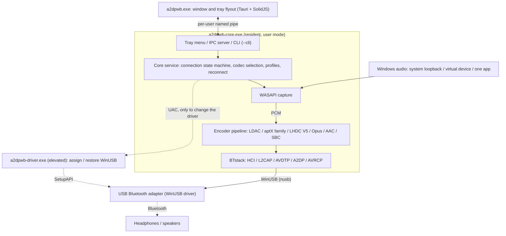

# A2DP Windows Bridge (A2DPWB)

Bluetooth A2DP audio streaming for Windows with full codec support.
Streams system audio via LDAC, aptX HD, aptX Low Latency, aptX, AAC, SBC or (experimental) LHDC V5 / Opus using a USB Bluetooth adapter in WinUSB mode — no kernel driver or test signing required.

**[Download](https://github.com/SeiyaFunaokaJP/A2DP-Windows-Bridge/releases/latest)** (installer `-setup.exe` or `-portable.zip`) | **[Documentation](https://seiyafunaokajp.github.io/A2DP-Windows-Bridge/)**

## Supported Codecs

| Codec | Bitrate | Sample Rate | Bit Depth | Latency |
|-------|---------|-------------|-----------|---------|
| LDAC | 330/660/990 kbps | 44.1–96 kHz | 16/24/32 bit | ~200 ms |
| aptX HD | 576 kbps | 44.1/48 kHz | 24 bit | ~150 ms |
| aptX Low Latency | 352 kbps | 44.1/48 kHz | 16 bit | ~32 ms |
| aptX | 352/384 kbps | 44.1/48 kHz | 16 bit | -- |
| AAC | 128/192/256 kbps | 44.1/48 kHz | 16 bit | ~150 ms |
| SBC | up to ~345 kbps | 44.1/48 kHz | 16 bit | ~150 ms |
| LHDC V5 🧪 | 400/500/900/1000 kbps, ABR 160–400 kbps | 44.1/48/96/192 kHz | 16/24 bit | -- |
| Opus 🧪 | 128/192/256 kbps | 48 kHz | 16 bit | -- |

### Codec support by platform (sending to headphones)

| Codec | Windows 10 built-in | Windows 11 built-in | Ubuntu built-in (PipeWire) | **A2DPWB** (Windows 10 / 11) |
|-------|:-------------------:|:-------------------:|:--------------------------:|:----------------------------:|
| LDAC | ❌ | ❌ | ✅ | ✅ |
| aptX HD | ❌ | ❌ | ✅ | 🧪 experimental |
| aptX Low Latency | ❌ | ❌ | ✅ | 🧪 experimental |
| aptX | ✅ | ✅ | ✅ | ✅ |
| AAC | ❌ | ✅ | ❌ not in Ubuntu's packages | ✅ |
| SBC | ✅ | ✅ | ✅ | ✅ |
| LHDC V5 | ❌ | ❌ | ❌ | 🧪 experimental |
| Opus (Android's A2DP Opus) | ❌ | ❌ | not checked | 🧪 experimental |
| aptX Adaptive | ❌ | ❌ | ❌ | ❌ |

✅ supported · 🧪 experimental · ❌ not supported. All columns are the sending side (PC → headphones). "Built-in" is the OS's own Bluetooth audio, without A2DPWB; the Ubuntu column is the PipeWire codec set of Ubuntu 26.04 (`libspa-0.2-bluetooth`).

> **aptX HD and aptX Low Latency are experimental.** They follow the Android / PipeWire implementations and pass encode/decode round-trip tests, but have not yet been verified with real headphones. Latency values in this table are typical figures, not measured with A2DPWB.

> **LHDC V5 is experimental.** It uses a C port of the LHDC V5 encoder that Google added to Android 17 (AOSP, Apache-2.0); the port was verified bit-exact against the AOSP Rust encoder over 114 configurations, and the A2DP signaling follows Android's `a2dp_vendor_lhdcv5`. It has not yet been verified with real LHDC headphones. Only lossy LHDC V5 is supported: LHDC V2/V3 (older headphones) and the lossless "LHDC-RAW" mode have no open-source encoder. In Auto mode LHDC V5 ranks below LDAC and the aptX family and above AAC / SBC.

> **Opus is experimental.** It is Android's A2DP Opus vendor codec (Android 13+, vendor ID 0x000000E0 Google): 48 kHz, 20 ms frames, 256 kbps stereo as Android requests it (Standard 192, Mobile 128 kbps), encoded with libopus 1.5.2. It passes the end-to-end test against a virtual sink, but has not yet been verified with real Opus headphones. In Auto mode it ranks below LHDC V5 and above AAC / SBC.

> **Only need classic aptX?** Windows 10 already supports classic aptX in its built-in Bluetooth stack (not aptX HD, aptX LL or aptX Adaptive), so A2DPWB is not required for it. A2DPWB is mainly useful for LDAC, aptX HD and aptX Low Latency.

> **aptX Adaptive is not supported.** There is no open-source aptX Adaptive encoder, so A2DPWB never selects it. If your headphones also list classic aptX (many aptX Adaptive models do), A2DPWB uses aptX directly; otherwise Auto picks AAC or SBC. See [aptX family and aptX Adaptive](#aptx-family-and-aptx-adaptive) below.

## Platform Support

| Component | Windows 10 (x64) | Windows 11 (x64) | Linux (Ubuntu) |
|-----------|:----------------:|:----------------:|:--------------:|
| **A2DPWB** (window, tray, CLI) | ✅ (not yet tried on real hardware) | ✅ | ❌ |
| Building from source (Rust, Visual Studio 2022+, Node.js) | ✅ | ✅ | ❌ |
| `a2dpwb_decode` (stream checker) | ✅ | ✅ | ❌ |
| End-to-end test `tools/emu/run_test.py` | ✅ | ✅ | ❌ |
| Virtual adapter `tools/emu/emu_vhci.py` | ❌ | ❌ | ✅ |
| Measuring receiver `tools/linux_sink` | ❌ | ❌ | ✅ |

A2DPWB itself runs on Windows only (Windows 10 22H2 or Windows 11), as an x64 build. The window uses the Microsoft Edge WebView2 Runtime, which Windows 11 includes and the installer adds when it is missing. The Linux tools need Python 3.11 or later (verified on Ubuntu 26.04); `setup.sh` targets Ubuntu / Debian, other distributions need the packages installed by hand.

## Verified Hardware

| What | Setup | Codecs | Result |
|-----|------|-------|-------|
| Sony WH-1000XM4 (headphones) | Windows 11 + TP-Link UB500 | LDAC, AAC, SBC | ✅ Plays (the XM4 has no aptX) |
| TP-Link UB500 (Realtek RTL8761BU, adapter) | Windows 11, WinUSB, linux-firmware `rtl8761bu` | – | ✅ |
| Measuring receiver `tools/linux_sink` | Windows 11 + UB500 → Ubuntu 26.04 over the air | SBC, AAC, aptX, aptX HD, aptX LL, LDAC | ✅ Received and measured |
| Virtual link `tools/emu` (Bumble) | Windows 11, no radio | SBC, AAC, aptX, aptX HD, aptX LL, LDAC, LHDC V5, Opus | ✅ End-to-end test passes |

Windows 10 has not been tried on real hardware yet. Other adapters: see [Recommended Adapters](https://seiyafunaokajp.github.io/A2DP-Windows-Bridge/setup#adapters).

## Architecture



The resident `a2dpwb-core.exe` streams the audio and owns the tray icon; the window `a2dpwb.exe` only shows its state and sends it requests, so closing the window (or the window crashing) does not stop the audio. See [Architecture](https://seiyafunaokajp.github.io/A2DP-Windows-Bridge/architecture).

### Components

| Directory | Description |
|-----------|-------------|
| `app/src/core/` | `a2dpwb-core.exe`: resident core (Bluetooth, audio, tray, IPC server, `--cli`) |
| `app/src/ui/` | `a2dpwb.exe`: the window (Tauri 2 + SolidJS) |
| `app/src/driver/` | `a2dpwb-driver.exe`: assigns / restores the WinUSB driver (elevated) |
| `app/src/crates/` | Rust libraries: BTstack bindings, HCI transports, Bluetooth host, codecs, audio pipeline, capture, Win32, core logic, IPC |
| `app/lang/` | Localization files (JSON) |
| `app/resources/` | Application icon and manifest |
| `extern/btstack/` | BTstack — user-mode Bluetooth stack (git submodule) |
| `extern/libldac/` | AOSP libldac — LDAC encoder (git submodule) |
| `extern/libopenaptx/` | libopenaptx — aptX / aptX HD / aptX LL encoder (git submodule) |
| `extern/fdk-aac/` | Fraunhofer FDK AAC — AAC-LC encoder (git submodule) |
| `extern/lhdcv5-enc/` | LHDC V5 encoder — C port of the AOSP encoder (git submodule, experimental) |
| `extern/opus/` | libopus 1.5.2 — Opus encoder (git submodule) |
| `compat/` | MSVC compatibility headers for the AOSP code |
| `installer/` | Release script (installer, portable zip, updater manifest) |
| `tools/a2dp_decode/` | `a2dpwb_decode` — checks / decodes the media stream in an HCI capture (developer tool) |
| `tools/emu/` | End-to-end test against a virtual Bluetooth sink (Python, Bumble) |
| `tools/linux_sink/` | `a2dpwb_sink` — measuring A2DP receiver on a second PC with Linux (Python, Bumble) |

## Prerequisites

- **Windows 10 (22H2) / 11** (x64)
- **Dedicated USB Bluetooth adapter** (separate from built-in Bluetooth)
- To build: **Rust**, **Visual Studio 2022 or later** with the C++ desktop workload, **Node.js** 22 with **pnpm**, **Git** (see [Building](https://seiyafunaokajp.github.io/A2DP-Windows-Bridge/building))

A2DPWB assigns the WinUSB driver to the adapter itself (one button, with a UAC prompt). [Zadig](https://zadig.akeo.ie/) is no longer needed, but it still works if you prefer it.

## Setup

1. **Install A2DPWB**: run `A2DPWB-<version>-win64-setup.exe` (per user, no administrator rights), or extract `A2DPWB-<version>-win64-portable.zip` and run `a2dpwb.exe`
2. **Plug in a dedicated USB Bluetooth adapter** (keep built-in Bluetooth for normal Windows use)
3. On first start, A2DPWB opens **Set up A2DPWB**, four steps:
   1. **Choose the adapter**
   2. **Driver and firmware**: **Assign WinUSB** (Windows asks for administrator permission), and for Realtek adapters the firmware files (below)
   3. **Find your headphones**: put them into pairing mode, **Scan Devices**, choose them and **Create profile**
   4. **Test**: connect and **Play test tone** (a higher tone on the right, a lower one on the left)
4. Afterwards, connect from **Home**, or from the tray icon without opening the window

> **Warning**: While WinUSB is assigned, Windows' own Bluetooth no longer sees the adapter. **Never assign WinUSB to your PC's built-in Bluetooth adapter** — keyboards, mice and audio devices paired through it would stop working. Always use a **separate, dedicated USB Bluetooth adapter** for A2DPWB. **Adapter > Restore driver** gives an adapter back to Windows at any time.

Upgrading from v1: the installer removes v1 and keeps the settings folder (`%APPDATA%\A2DPWB`), so profiles, pairings and firmware carry over without pairing the headphones again. The adapter keeps its WinUSB driver.

### Firmware Files (Realtek adapters)

Realtek-based USB Bluetooth adapters (e.g., TP-Link UB500, RTL8761BU dongles) require proprietary firmware to operate. CSR adapters need no firmware. Intel and Broadcom adapters (experimental) may need firmware files of their own: see the [Setup guide](https://seiyafunaokajp.github.io/A2DP-Windows-Bridge/setup#adapters).

**In the app:** the **Adapter** screen (and the setup's **Driver and firmware** step) shows whether the firmware is present and which files are needed. **Open Download Page** opens the [linux-firmware/rtl_bt](https://git.kernel.org/pub/scm/linux/kernel/git/firmware/linux-firmware.git/tree/rtl_bt) page in your browser, and **Open Config Folder** opens the destination folder. Download the `.bin` files and place them in the config folder.

**Manual:**

1. Download the firmware and config `.bin` files for your chipset from <https://git.kernel.org/pub/scm/linux/kernel/git/firmware/linux-firmware.git/tree/rtl_bt> (e.g., `rtl8761bu_fw.bin` and `rtl8761bu_config.bin`)
2. Place both files in the A2DPWB config folder (`%APPDATA%\A2DPWB`, also under **Settings > Settings folder**)

> **License**: These firmware files are proprietary Realtek binaries distributed via the linux-firmware project. They are not included in this repository. See [linux-firmware WHENCE](https://git.kernel.org/pub/scm/linux/kernel/git/firmware/linux-firmware.git/tree/WHENCE) for redistribution terms.

## Building

```bash
git clone --recursive https://github.com/SeiyaFunaokaJP/A2DP-Windows-Bridge.git
cd A2DP-Windows-Bridge
cargo build --release -p a2dpwb-core-exe -p a2dpwb-driver
cd app/src/ui && pnpm install && pnpm build && cd ../../..
cargo build --release -p a2dpwb-ui
```

The programs (`a2dpwb-core.exe`, `a2dpwb.exe`, `a2dpwb-driver.exe`) are written to `target/release/`. See [Building](https://seiyafunaokajp.github.io/A2DP-Windows-Bridge/building) for tests, release packages and the emulator test.

## Usage

### The window and the tray

Start **A2DP Windows Bridge** from the Start menu (or `a2dpwb.exe`). The window has five screens:

- **Home**: the device and its state, the big **Connect** / **Disconnect** button, the headphone volume, the codec, the capture source and the link quality
- **Profiles**: device + sound combinations. The editor finds the headphones (**Scan Devices**, or enter the address), compares the codecs (sound quality, low latency, stability), and sets the capture source and **Windows Volume Sync**; **Advanced** has the quality mode (LDAC HQ / SQ / MQ, LHDC V5 High / Medium-High / Standard / Mobile), ABR, sample rate, bit depth and the max media packet size
- **Diagnostics**: link quality (bitrate, send queue, drops, radio time, RSSI, AFH channels), the connection flow step by step, the log, HCI capture, **Copy Diagnostics**
- **Adapter**: the detected adapters, their driver (**Assign WinUSB** / **Restore driver**), firmware and Bluetooth chip, AFH, **Restart Bluetooth**
- **Settings**: language, theme, startup, headphone buttons, remembered volume, updates, developer mode, about

Closing the window leaves A2DPWB in the tray: streaming goes on. **Left-click** the tray icon for the flyout (connect / disconnect, volume, profile, codec, link quality, **Open app**); **right-click** it for the menu (**Open A2DPWB**, up to 10 profiles to connect, **Disconnect**, **Exit**). **Settings > Quit A2DPWB** or the tray's **Exit** stop streaming and close A2DPWB completely.

### CLI Mode

The resident program also runs from the command line. Quit A2DPWB first (tray > **Exit**): only one program can use the adapter at a time.

```bash
# Auto-select best codec
a2dpwb-core.exe --cli -d AA:BB:CC:DD:EE:FF

# Specify codec
a2dpwb-core.exe --cli -d AA:BB:CC:DD:EE:FF -c ldac
a2dpwb-core.exe --cli -d AA:BB:CC:DD:EE:FF -c aptxhd
a2dpwb-core.exe --cli -d AA:BB:CC:DD:EE:FF -c aptxll
a2dpwb-core.exe --cli -d AA:BB:CC:DD:EE:FF -c aptx
a2dpwb-core.exe --cli -d AA:BB:CC:DD:EE:FF -c aac
a2dpwb-core.exe --cli -d AA:BB:CC:DD:EE:FF -c sbc

# LDAC quality modes
a2dpwb-core.exe --cli -d AA:BB:CC:DD:EE:FF -c ldac -q hq   # 990 kbps (default)
a2dpwb-core.exe --cli -d AA:BB:CC:DD:EE:FF -c ldac -q sq   # 660 kbps
a2dpwb-core.exe --cli -d AA:BB:CC:DD:EE:FF -c ldac -q mq   # 330 kbps

# LHDC V5: hq 1000 / mhq 900 / sq 500 / mq 400 kbps (Android's four levels)
a2dpwb-core.exe --cli -d AA:BB:CC:DD:EE:FF -c lhdcv5 -q mhq  # 900 kbps

# Enable ABR (Adaptive Bit Rate; LDAC and LHDC V5)
a2dpwb-core.exe --cli -d AA:BB:CC:DD:EE:FF -c ldac -a

# Virtual audio device capture (e.g. VB-CABLE)
a2dpwb-core.exe --cli -d AA:BB:CC:DD:EE:FF -m virtual --audio-device "{device-id}"

# One application's audio
a2dpwb-core.exe --cli -d AA:BB:CC:DD:EE:FF -m app --app spotify.exe

# Find nearby devices with the USB adapter (10 seconds)
a2dpwb-core.exe --cli --scan

# Show all options
a2dpwb-core.exe --cli -h
```

All options, including AFH (`--afh`) and the peer receiver test (`--remote-sink`), are listed in the [Usage guide](https://seiyafunaokajp.github.io/A2DP-Windows-Bridge/usage#all-options).

> **Note**: System loopback and virtual device capture use WASAPI shared mode. The capture sample rate depends on the device's format configured in Windows Sound settings (typically 48 kHz). To use LDAC at 96 kHz, change the device format to 96 kHz in Sound settings > Advanced. Application capture is converted by Windows to the rate A2DPWB asks for.

Auto-select priority: LDAC > aptX HD > aptX LL > aptX > LHDC V5 (experimental) > Opus (experimental) > AAC > SBC

### aptX family and aptX Adaptive

A2DPWB encodes aptX, aptX HD and aptX Low Latency with libopenaptx. For these codecs it picks 44.1 or 48 kHz from the rates the headphones advertise and lets WASAPI resample, so no Sound settings change is needed.

**aptX Adaptive is not supported**: no open-source aptX Adaptive encoder exists, so A2DPWB only detects and logs it. A2DPWB does not "fall back" from Adaptive to aptX — the headphones advertise a list of codecs, and aptX Adaptive is simply never a candidate:

- If the headphones also list **classic aptX** (common, as aptX Adaptive is marketed as backward compatible), A2DPWB selects aptX directly.
- If they list **only aptX Adaptive**, aptX is not possible; Auto picks AAC or SBC.
- A codec chosen in a profile that the headphones don't list is replaced by the best one they offer (the profile's **Use another codec if this one is not available**, on by default), and Home says which codec is used instead and why. With the option off, and in the **CLI** (`-c <codec>`), the connection stops with an error.

To see exactly which codecs your headphones offer, connect once and look for the `capability discovery complete (...)` line in **Diagnostics > Log**. See the [Usage guide](https://seiyafunaokajp.github.io/A2DP-Windows-Bridge/usage#aptx-compatibility) for details.

### Auto-start (Run on boot)

You can configure A2DPWB to start automatically when you sign in to Windows.

**In the app:**
Turn on **Settings > Start with Windows**. A2DPWB then starts in the background with only its tray icon; the window opens from the tray.

**Manual Configuration (regedit):**
The auto-start behavior is controlled by the standard Windows registry key.
- **Key**: `HKEY_CURRENT_USER\Software\Microsoft\Windows\CurrentVersion\Run`
- **Value Name**: `A2DPWB`
- **Value Data**: `"<Path-to-a2dpwb-core.exe>" --background`

You can manually add this entry using `regedit` if needed. To disable it manually (e.g., if the window does not open), simply delete the `A2DPWB` value from this registry key. Installing v2 over v1 rewrites v1's value (`A2DPWB.exe --minimized`) to the new one.

## Features

- **Multi-codec support**: LDAC, aptX HD, aptX Low Latency, aptX, AAC, SBC and (experimental) LHDC V5 and Opus with automatic negotiation
- **Three capture modes**: System loopback (all system audio), virtual audio device (per-app routing via VB-CABLE etc.), or one application's output (Windows 11 / Windows 10 2004+)
- **Streams with the window closed**: a small resident core with a tray icon and flyout; the window starts only when you open it
- **WinUSB in the app**: assigns the WinUSB driver to the adapter and restores the original driver, without Zadig
- **First-run setup**: adapter, driver and firmware, headphones, test tone
- **ABR**: Adaptive Bit Rate for unstable connections (LDAC and LHDC V5)
- **Auto-reconnect**: Reconnects on Bluetooth disconnection (up to 10 attempts); a failed connection is retried (up to 3 attempts); after the PC sleeps, A2DPWB reconnects once it resumes
- **Link quality and AFH**: Shows what is sent, the RSSI and the channels in use; tells the adapter which Wi-Fi channels to avoid
- **Headphone controls (AVRCP)**: Volume slider synced with the headphones; their play/pause, next and previous buttons control playback on the PC
- **Auto-start**: Optionally start in the background (tray icon only) when you sign in
- **Profile management**: Device + codec + capture configurations, connectable from the tray
- **Updates**: Daily update check (optionally including pre-releases); the installed version updates itself with **Update now**, after streaming stops
- **Localization**: English, Japanese, Simplified / Traditional Chinese, Korean, German, French and Spanish UI (languages other than English and Japanese are machine-translated; corrections welcome — `python tools/check_lang.py` checks a language file against `en.json`)
- **Realtek firmware**: Guided firmware download for Realtek adapters
- **Diagnostics**: connection flow, filterable log, HCI capture, **Copy Diagnostics** for bug reports; peer receiver test against a Linux PC (CLI `--remote-sink`)
- **MTU-aware framing**: Optimal packet utilization for each codec
- **PCM residual buffering**: Prevents audio data loss at encoder boundaries

## License

This project is dual-licensed under the **Apache License 2.0** ([LICENSE-APACHE](LICENSE-APACHE)) or the **MIT License** ([LICENSE-MIT](LICENSE-MIT)), at your option (SPDX `Apache-2.0 OR MIT`). See [LICENSE](LICENSE).

> **Important:** The A2DPWB source code is dual-licensed under Apache-2.0 or MIT. The distributed programs include BTstack (in `a2dpwb-core.exe`) and therefore may only be used and redistributed for personal, non-commercial purposes.

Third-party libraries are used under their respective licenses. See [THIRD_PARTY_LICENSES.md](THIRD_PARTY_LICENSES.md) for details.

> **BTstack** is licensed under the BTstack License, a BSD-3-Clause-style license with an additional non-commercial clause ("Any redistribution, use, or modification is done solely for personal benefit and not for any commercial purpose or for monetary gain."). It is not BSD-3-Clause. Commercial licenses are available from BlueKitchen GmbH.

## References

- [BTstack](https://github.com/bluekitchen/btstack) — Bluetooth stack with WinUSB support (source-available; non-commercial license)
- [libldac (AOSP)](https://android.googlesource.com/platform/external/libldac) — LDAC encoder library
- [libopenaptx](https://github.com/pali/libopenaptx) — Open-source aptX / aptX HD encoder (also used for aptX LL)
- [fdk-aac](https://github.com/mstorsjo/fdk-aac) — Fraunhofer FDK AAC codec library
- [LHDC-V5-Encoder](https://github.com/WillyBilly06/LHDC-V5-Encoder) — portable C port of the [AOSP LHDC V5 encoder](https://android.googlesource.com/platform/packages/modules/Bluetooth/+/refs/heads/android17-release/system/audio/codecs/lhdcv5/) (Apache-2.0)
- [Tauri](https://tauri.app/) — the window (WebView2) and its installer / updater
- [SolidJS](https://www.solidjs.com/) — UI library of the window
- [Fluent UI System Icons](https://github.com/microsoft/fluentui-system-icons) — icons (MIT)
- [nusb](https://github.com/kevinmehall/nusb) — USB access (WinUSB) in Rust
- [Zadig](https://zadig.akeo.ie/) — USB driver installer, an alternative to the in-app WinUSB assignment
