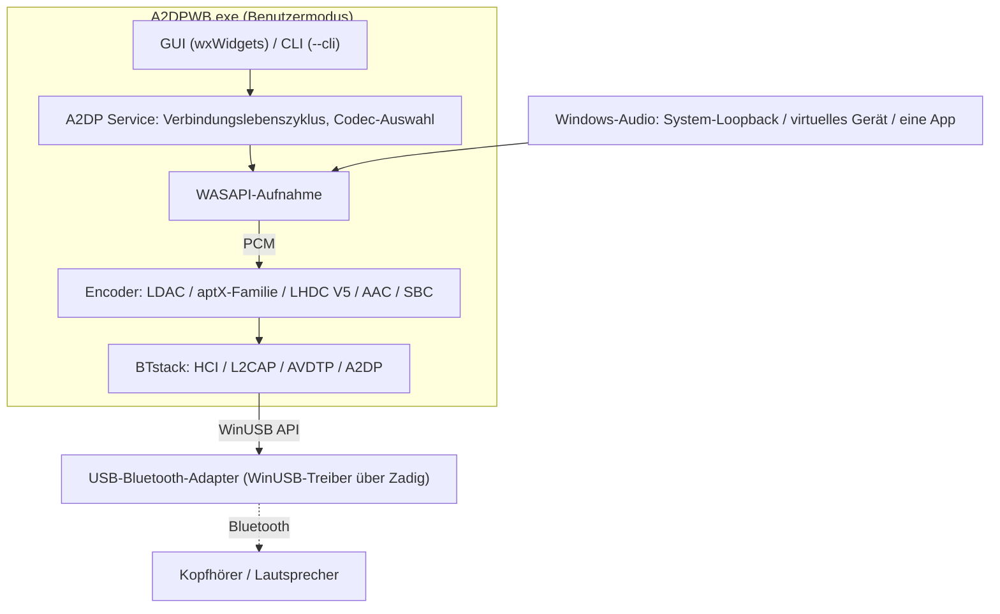
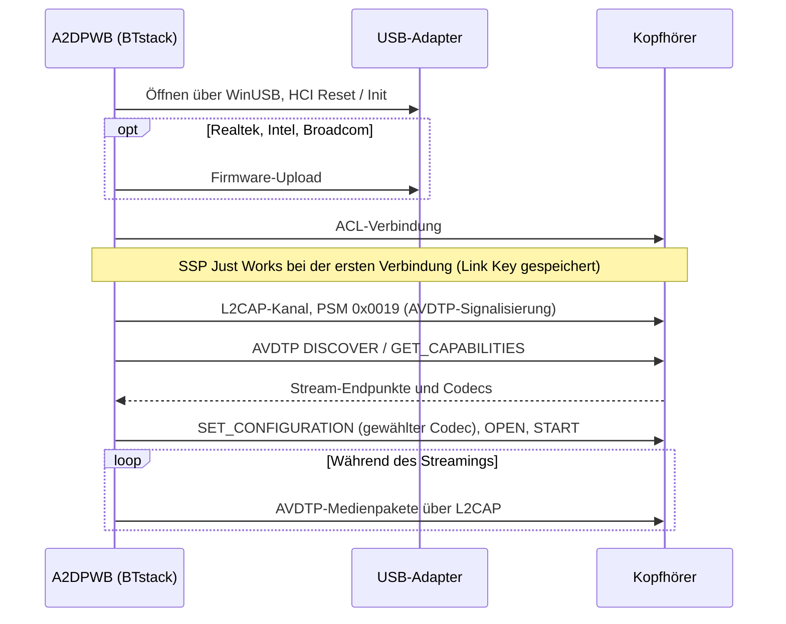
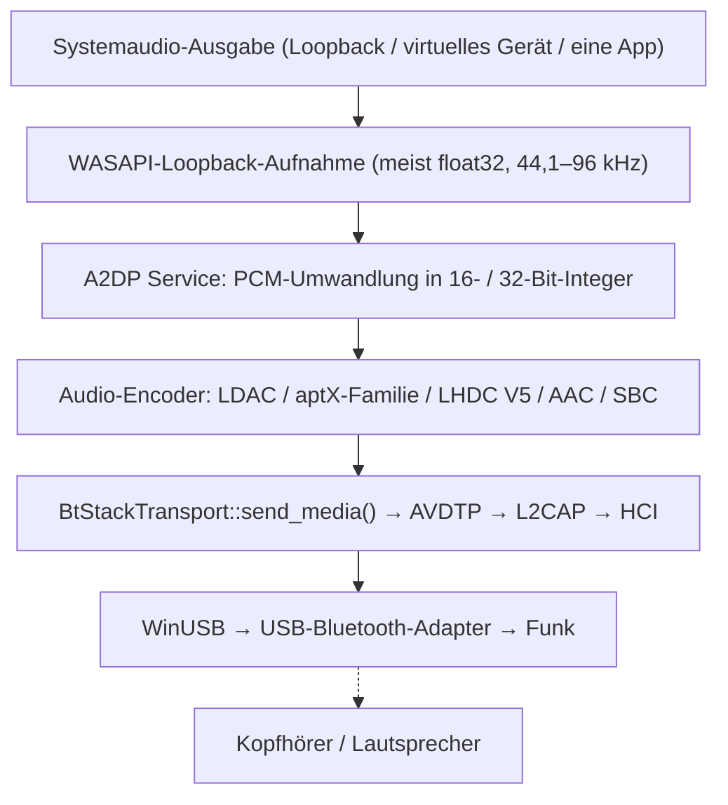
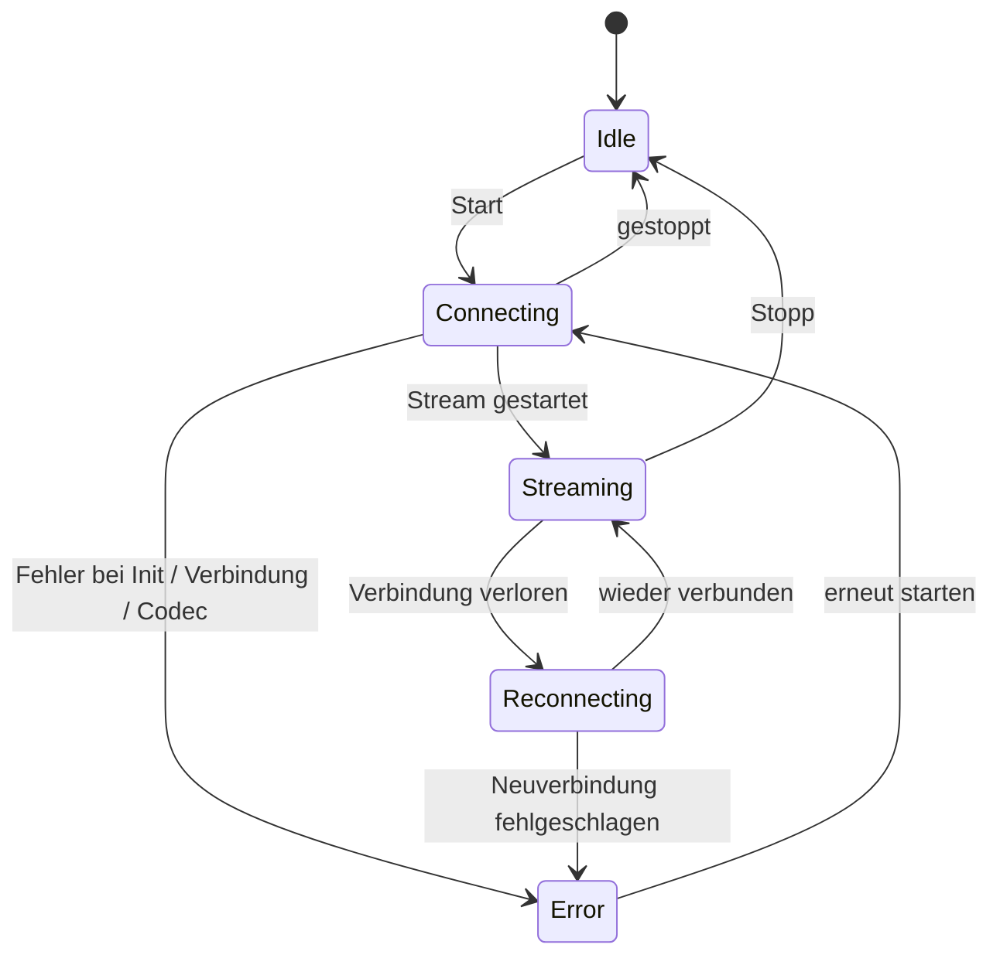

# Architektur
{: .no_toc }

## Inhalt
{: .no_toc .text-delta }

1. TOC
{:toc}

---

## Überblick

A2DP Windows Bridge (A2DPWB) ermöglicht Bluetooth-Audio mit LDAC, aptX HD, aptX Low Latency, aptX,
AAC und SBC unter Windows. Der eigene Bluetooth-Stack von Windows unterstützt für A2DP
nur SBC, klassisches aptX und (nur unter Windows 11) AAC — dieses Werkzeug ergänzt LDAC, aptX HD und aptX
Low Latency, ohne einen Kerneltreiber zu benötigen.

Verwendet **BTstack + WinUSB** — vollständig im Benutzermodus, keine Treibersignatur nötig.



## Warum die Einrichtung diese Schritte braucht

Mit einem eigenen Audiotreiber wäre A2DPWB eine normale Installation: Die Kopfhörer erschienen als gewöhnliches Windows-Audiogerät am eingebauten Bluetooth. Windows 10 / 11 lädt aber nur Kernelmodustreiber, die über Microsoft signiert sind, und dafür ist ein EV-Codesignaturzertifikat nötig. Solche Zertifikate kosten etwa 300–700 USD pro Jahr und werden in der Regel nur an eingetragene Unternehmen ausgegeben – zu viel für ein Einzelprojekt. A2DPWB geht deshalb den Umweg: Es nimmt Windows mit dem von Microsoft signierten WinUSB-Treiber einen ganzen USB-Bluetooth-Adapter weg und betreibt den Bluetooth-Stack selbst im Benutzermodus. Darum werden ein eigener Adapter, Zadig und (bei Realtek-Adaptern) Firmwaredateien gebraucht.

Wer es einfach haben möchte: Es gibt kommerzielle Software mit signiertem Treiber, die mit dem eingebauten Bluetooth funktioniert. Ehrlich gesagt ist sie für das, was sie leistet, bemerkenswert günstig – wenn Ihnen eine einfache Einrichtung am wichtigsten ist, nehmen Sie lieber diese.

## Transport: BTstack + WinUSB

Umgeht den Bluetooth-Stack von Windows vollständig, indem direkt über WinUSB (der von Microsoft
signierte generische USB-Treiber) mit einem USB-Bluetooth-Adapter kommuniziert wird. BTstack,
ein Bluetooth-Stack mit verfügbarem Quellcode (nicht kommerzielle Lizenz), implementiert HCI, L2CAP, AVDTP und A2DP im
Benutzermodus.

**Vorteile**:
- Keine Kosten für eine Treibersignatur
- Kein Testsignaturmodus erforderlich
- Secure Boot muss nicht deaktiviert werden
- Der gesamte Code läuft im Benutzermodus (einfacheres Debugging)

**Nachteile**:
- Erfordert einen eigenen USB-Bluetooth-Adapter (getrennt vom integrierten
  Bluetooth von Windows)
- Solange WinUSB den Adapter belegt, steht er für das normale Windows-Bluetooth
  nicht zur Verfügung
- Die Geräteadresse wird manuell eingegeben, aus der Liste der unter Windows gekoppelten
  Geräte gewählt (über den integrierten Adapter gelesen) oder per Suche (GAP Inquiry) mit
  dem USB-Adapter gefunden

**Funktionsweise**:
1. Der Benutzer installiert mit Zadig den WinUSB-Treiber für einen USB-Bluetooth-Adapter
2. BTstack öffnet das USB-Gerät über die WinUSB-API
3. BTstack sendet HCI-Befehle, um den Bluetooth-Controller zu initialisieren
4. (Realtek-, Intel- und Broadcom-Adapter) Bei Bedarf wird Firmware hochgeladen
5. BTstack baut eine ACL-Verbindung auf und öffnet L2CAP-Kanäle (PSM 0x0019)
6. Die AVDTP-Signalisierung ermittelt die SEPs der Gegenseite und handelt die Codecs aus
7. Das kodierte Audio wird als AVDTP-Medienpakete über L2CAP gesendet



## Modulstruktur

```
A2DPWB.exe
├── GUI-Schicht (wxWidgets)
│   ├── wx_app              Einstiegspunkt der App, Ereignisschleife
│   ├── wx_main_frame       Hauptfenster (Gerät, Codec, Status)
│   ├── wx_profile_dialog   Verwaltung der Verbindungsprofile, Gerätesuche
│   ├── wx_firmware_dialog  Download der Realtek-Firmware
│   ├── wx_about_dialog     Info / Lizenzinformationen
│   ├── wx_zadig_dialog     Anleitung zur WinUSB-Installation mit Zadig
│   ├── wx_link_quality_dialog  Fenster Verbindungsqualität (was gesendet wird, Funk)
│   ├── wx_receiver_dialog  Peer-Empfängertest (gesendet vs. empfangen, Debugmodus)
│   ├── wx_debug_console_dialog  Debugkonsole: Live-Protokoll, Verbindungsablauf
│   ├── wx_radio_text.h     RSSI / AFH als Text für beide Fenster
│   ├── theme_manager       Unterstützung für helles / dunkles Design
│   └── localization        i18n (en, ja, zh-CN, zh-TW, ko, de, fr, es — eingebettetes JSON)
│
├── Kernschicht
│   ├── a2dp_service        A2DP-Verbindungslebenszyklus und Zustandsautomat
│   ├── btstack_transport   BTstack-Integration (HCI, L2CAP, AVDTP, A2DP)
│   ├── btstack_link_key_db_file  Speicherung der Link Keys (Datei im Konfigurationsordner)
│   ├── btstack_uart_tcp_windows  H4 über TCP zu einem virtuellen Controller (--hci-tcp, Tests)
│   ├── wasapi_capture      WASAPI-Loopback-Audioaufnahme
│   ├── test_tone           Testton statt aufgenommenem Audio
│   ├── audio_encoder       Encoder-Schnittstelle (abstrakte Basisklasse)
│   │   ├── ldac_encoder        LDAC (libldac, mit ABR)
│   │   ├── aptxhd_encoder      aptX HD (libopenaptx)
│   │   ├── aptxll_encoder      aptX Low Latency (libopenaptx)
│   │   ├── aptx_encoder        klassisches aptX (libopenaptx)
│   │   ├── aptx_pcm_pack.h     Gemeinsamer Helfer PCM → gepacktes 24 Bit für die aptX-Encoder
│   │   ├── aac_encoder         AAC-LC (fdk-aac, LATM-Transport)
│   │   └── a2dp_sbc_encoder    SBC (BTstack Bluedroid)
│   │
│   ├── bt_device           Informationen zum Bluetooth-Gerät (Adresse, Name, Codecs)
│   ├── bt_adapter_enum     Auflistung der USB-Bluetooth-Adapter (WinUSB)
│   ├── audio_device_enum   Auflistung der WASAPI-Audiogeräte
│   ├── profile_manager     Speicherung der Verbindungsprofile (JSON)
│   ├── media_payload_limit Max. Mediapaketgröße (Bereich, Standard)
│   ├── afh                 AFH-Host-Kanalklassifizierung aus dem Wi-Fi-Scan
│   ├── link_stats          Zähler für das Fenster Verbindungsqualität
│   └── remote_sink_client  Statistik von tools/linux_sink über das Netzwerk
│
├── Unterstützung
│   ├── app_settings        Dauerhafte Anwendungseinstellungen (JSON)
│   ├── config_path         Ermittlung des Pfads der Konfigurationsdateien
│   ├── system_integration  Infobereich, Autostart
│   ├── debug_log           Makros für das Debug-Protokoll
│   ├── debug_log_model     Protokollzeilen und Verbindungsablauf für die Debugkonsole
│   ├── hci_capture         HCI-Aufzeichnung auf Abruf (.pklg)
│   ├── update_checker      Updateprüfung (GitHub Releases)
│   ├── zadig_helper        Download / Start von Zadig
│   ├── embedded_langs      Beim Build eingebettete Sprachdateien
│   └── capture_mode        Definitionen der Audio-Aufnahmemodi
│
└── CLI-Modus
    └── main.cpp            Auswertung der CLI-Argumente, Streaming ohne Oberfläche
```

## Datenfluss



## Wichtige Module

### A2DP Service (`a2dp_service.cpp`)

Zentrale Verwaltung des Verbindungslebenszyklus. Koordiniert:
- Codec-Aushandlung (automatische Auswahl oder vom Benutzer festgelegt)
- Registrierung der Stream-Endpunkte für alle unterstützten Codecs
- Wahl der Abtastrate für die aptX-Familie (44,1 / 48 kHz aus den Raten, die die Gegenseite
  meldet; WASAPI rechnet die Aufnahme um)
- PCM-Umwandlung (float32 → 16- / 32-Bit-Integer) für den Encoder
- Zustandsautomat der Verbindung (idle → connecting → streaming → reconnecting, error)
- Logik für die automatische Neuverbindung nach unerwartetem Verbindungsabbruch
- Senden der Medienpakete mit codecspezifischer Rahmung

Der Zustandsautomat der Verbindung (`A2dpService::State`):



### BTstack Transport (`btstack_transport.cpp`)

Brücke zwischen dem synchronen Modell der Anwendung und der ereignisgesteuerten
API von BTstack.

**Aufgaben**:
- BTstack mit dem WinUSB-HCI-Transport initialisieren
- Die BTstack-Ereignisschleife in einem eigenen Thread ausführen
- Stream-Endpunkte registrieren: Hersteller-Codecs (LDAC, aptX HD, aptX, aptX LL)
  sowie SBC und AAC
- SDP-Einträge registrieren (A2DP Source, AVRCP Controller, AVRCP Target)
- Die Fähigkeiten der Gegenseite auswerten, einschließlich aptX LL unter beiden Vendor IDs und
  aptX Adaptive (nur erkannt und protokolliert)
- Den A2DP-Verbindungslebenszyklus über asynchron-zu-synchron-Wrapper abwickeln
- SSP-Kopplung verwalten (Just Works, General Bonding; Link Keys werden gespeichert)
- Eine halboffene Verbindung nach einer Zeitüberschreitung beim Verbinden abbauen, damit erneute Versuche funktionieren
- Eine fehlgeschlagene Verbindung erneut versuchen (bis zu 3 Versuche) und die Ursachen unterscheiden (keine
  Antwort, stumme Verbindung, Gegenseite hat die Verbindung beendet, Authentifizierung); einen Link Key
  verwerfen, den das Gerät nicht mehr kennt, und erneut koppeln
- GAP Inquiry für die Gerätesuche
- AFH-Host-Kanalklassifizierung sowie RSSI- / AFH-Werte für das Fenster
  Verbindungsqualität
- Threadsicheres Senden von Medien für den WASAPI-Callback bereitstellen
- Laden der Firmware für Realtek-, Intel- und Broadcom-Chipsätze

**Wichtige verwendete BTstack-APIs**:
- `a2dp_source_create_stream_endpoint()` — Codec-Endpunkte registrieren
- `a2dp_source_establish_stream()` — Mit der A2DP-Senke verbinden
- `a2dp_source_set_config_other()` — Herstellerspezifischen Codec konfigurieren
- `a2dp_source_stream_send_media_payload_rtp()` — Kodiertes Audio mit einem
  RTP-Header senden (LDAC, aptX HD, AAC, SBC)
- `a2dp_source_stream_send_media_packet()` — Rohe Medienpakete ohne
  RTP-Header senden (aptX, aptX LL)

### WASAPI-Aufnahme (`wasapi_capture.cpp`)

Nimmt die Systemaudio-Ausgabe in Echtzeit über die Windows Audio Session API auf.
- Verwendet `IAudioClient` im Modus `AUDCLNT_STREAMFLAGS_LOOPBACK`
- Liefert das Mixformat des Geräts im gemeinsamen Modus (meist float32; der A2DP Service
  wandelt es für den Encoder um)
- Konfigurierbare Auswahl des Audiogeräts

### Audio-Encoder

| Encoder | Bibliothek | Bitrate | Merkmale |
|---------|------------|---------|----------|
| LDAC | libldac (AOSP) | 330/660/990 kbps | Modi HQ/SQ/MQ, ABR |
| aptX HD | libopenaptx | 576 kbps | 24-Bit-Eingang, feste Rate, RTP-Header |
| aptX LL | libopenaptx | 352 kbps | ca. 32 ms Latenz, kein RTP-Header, Pakete ≤ ca. 7,5 ms |
| aptX | libopenaptx | 352/384 kbps (44,1/48 kHz) | 16 Bit Stereo, kein RTP-Header |
| AAC | fdk-aac | bis 256 kbps | AAC-LC, LATM-Transport |
| SBC | BTstack Bluedroid | bis ca. 345 kbps | Verpflichtende A2DP-Grundlage |
| LHDC V5 | lhdcv5-enc (C-Portierung des AOSP-Encoders) | 400/500/900/1000 kbps, ABR 160–400 kbps | 16/24 Bit, 5-ms-Frames, 2 Byte Header der Mediennutzdaten, RTP-Header |

Alle Encoder implementieren die Schnittstelle `AudioEncoder` mit den Methoden `encode()` und
`get_frame_size()`.

libopenaptx erwartet Gruppen von 4 Stereo-Samples als gepacktes 24-Bit-Little-Endian-PCM.
`aptx_pcm_pack.h` wandelt die 16-Bit- oder 32-Bit-Samples (MSB-ausgerichtet) der Aufnahme
für die Encoder von aptX, aptX HD und aptX LL in dieses Format um; ein Mono-Eingang
wird auf beide Kanäle dupliziert.

## Codec Information Elements der Hersteller-Codecs

Nicht standardisierte Codecs werden in AVDTP als Vendor Specific registriert:

| Codec | Vendor ID | Codec ID |
|-------|-----------|----------|
| LDAC | Sony (0x0000012D) | 0x00AA |
| aptX | APT (0x0000004F) | 0x0001 |
| aptX HD | Qualcomm (0x000000D7) | 0x0024 |
| aptX Low Latency | CSR (0x0000000A) oder Qualcomm (0x000000D7) | 0x0002 |
| aptX Adaptive | Qualcomm (0x000000D7) | 0x00AD (nur erkannt, nie ausgewählt) |
| LHDC V5 | Savitech (0x0000053A) | 0x4C35 |

AAC und SBC verwenden die in der A2DP-Spezifikation definierten Standard-Codec-IDs.

Größen der Codec Information Elements (einschließlich der 6 Byte für Vendor ID / Codec ID):

- **aptX**: 7 Byte (Byte 6 = Abtastrate / Kanalmodus)
- **aptX HD**: 11 Byte (Byte 6 wie bei aptX, dazu 4 reservierte Byte); Stereo ist
  erforderlich
- **aptX LL**: 8 Byte, oder 17 Byte, wenn die Senke das erweiterte Flag
  („new caps“) setzt. A2DPWB registriert einen aptX-LL-Endpunkt und konfiguriert den
  Stream mit der Vendor ID, die die Senke verwendet hat
- **LHDC V5**: 11 Byte (Android `a2dp_vendor_lhdcv5_constants.h`): Byte 6
  Abtastraten (0x20 44,1k, 0x10 48k, 0x04 96k, 0x01 192k), Byte 7 Bittiefe
  (0x04 16 Bit, 0x02 24 Bit) und die minimale/maximale Bitrate der Senke, Byte 8
  Codec-Unterversion (0x01 = V5 ver.1) und 0x10 = 5-ms-Frames, Byte 9-10
  optionale Funktionen (Low Latency, Lossless, JAS, AR, META), von denen
  A2DPWB keine anbietet. Nur Stereo. Die Bitratengrenzen der Senke werden in der
  Konfiguration zurückgegeben und auf den Encoder angewendet, wie bei Android. Medienpakete
  tragen einen 2 Byte langen Nutzdaten-Header: Frame-Anzahl << 2 (Latenz-Bits 0) und eine
  Sequenznummer

**RTP oder kein RTP**: Die Medienpakete von LDAC, aptX HD, AAC, SBC und LHDC V5 tragen den
12 Byte langen RTP-Header. aptX und aptX LL werden **ohne** RTP-Header gesendet (wie bei Android und
PipeWire), sodass die gesamte L2CAP-MTU für aptX-Frames zur Verfügung steht.

**aptX Adaptive** hat keinen Open-Source-Encoder (libopenaptx implementiert es
nicht), daher registriert oder wählt A2DPWB es nie. Führt eine Senke es auf, protokolliert A2DPWB
es nur; klassisches aptX wird verwendet, wenn die Senke dieses separat aufführt.

## Build-System

- **CMake** mit MSVC (Visual Studio 2022 oder neuer)
- Bibliotheken von Drittanbietern werden als statische Bibliotheken aus dem Quellcode gebaut
- wxWidgets wird beim Konfigurieren per CMake FetchContent abgerufen (v3.2.6)
- Sprachdateien (JSON) werden beim Konfigurieren in die ausführbare Datei eingebettet
- Anwendungsmanifest und Symbol werden über ein Windows-Ressourcenskript kompiliert

## Wichtige Hinweise

- **Adapterkompatibilität**: Realtek- (am besten getestet) und CSR-USB-Adapter; Intel und
  Broadcom sind experimentell. Realtek-Adapter benötigen beim Start einen Firmware-Upload,
  Intel-Adapter im Bootloader-Modus ebenfalls
- **Kopplung**: Verwendet SSP Just Works mit General Bonding. Link Keys werden
  in einer lokalen Datei gespeichert
- **Zweiter Adapter empfohlen**: Das integrierte Bluetooth für Windows behalten und
  einen eigenen USB-Adapter für A2DPWB verwenden
- Die Firmware mancher Bluetooth-Adapter begrenzt die erreichbare Bitrate
- USB-Bluetooth-Adapter ab Version 5.0 eignen sich im Allgemeinen gut für LDAC
- Priorität der automatischen Codec-Auswahl: LDAC > aptX HD > aptX LL > aptX > LHDC V5 > AAC > SBC
