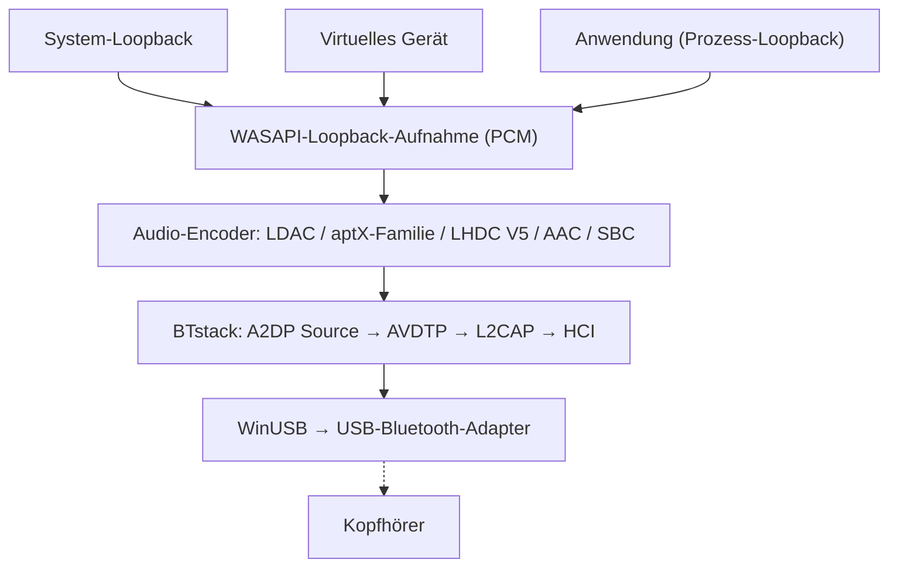

# A2DP Windows Bridge (A2DPWB)

Bluetooth-A2DP-Audiostreaming für Windows mit voller Codec-Unterstützung.
{: .fs-6 .fw-300 }

Streamt das Systemaudio über **LDAC, aptX HD, aptX Low Latency, aptX, AAC, SBC** und (experimentell) **LHDC V5** mit einem USB-Bluetooth-Adapter im WinUSB-Modus -- ohne Kerneltreiber und ohne Testsignatur.

[Erste Schritte](setup){: .btn .btn-primary .fs-5 .mb-4 .mb-md-0 .mr-2 }
[GitHub](https://github.com/SeiyaFunaokaJP/A2DP-Windows-Bridge){: .btn .fs-5 .mb-4 .mb-md-0 }

---

## Unterstützte Codecs

| Codec | Bitrate | Abtastrate | Bittiefe | Latenz |
|:------|:--------|:-----------|:---------|:-------|
| LDAC | 330/660/990 kbps | 44,1--96 kHz | 16/24/32 Bit | ~200 ms |
| aptX HD | 576 kbps | 44,1/48 kHz | 24 Bit | ~150 ms |
| aptX Low Latency | 352 kbps | 44,1/48 kHz | 16 Bit | ~32 ms |
| aptX | 352/384 kbps | 44,1/48 kHz | 16 Bit | -- |
| AAC | 128/192/256 kbps | 44,1/48 kHz | 16 Bit | ~150 ms |
| SBC | bis ca. 345 kbps | 44,1/48 kHz | 16 Bit | ~150 ms |
| LHDC V5 🧪 | 400/500/900/1000 kbps, ABR 160--400 kbps | 44,1/48/96/192 kHz | 16/24 Bit | -- |

### Codec-Unterstützung nach Plattform (Senden an Kopfhörer)

| Codec | Windows 10 integriert | Windows 11 integriert | Ubuntu integriert (PipeWire) | **A2DPWB** (Windows 10 / 11) |
|:------|:---------------------:|:---------------------:|:----------------------------:|:----------------------------:|
| LDAC | ❌ | ❌ | ✅ | ✅ |
| aptX HD | ❌ | ❌ | ✅ | 🧪 experimentell |
| aptX Low Latency | ❌ | ❌ | ✅ | 🧪 experimentell |
| aptX | ✅ | ✅ | ✅ | ✅ |
| AAC | ❌ | ✅ | ❌ nicht in den Ubuntu-Paketen | ✅ |
| SBC | ✅ | ✅ | ✅ | ✅ |
| LHDC V5 | ❌ | ❌ | ❌ | 🧪 experimentell |
| aptX Adaptive | ❌ | ❌ | ❌ | ❌ |

✅ unterstützt · 🧪 experimentell · ❌ nicht unterstützt. Alle Spalten beziehen sich auf die Sendeseite (PC → Kopfhörer). „Integriert“ ist das Bluetooth-Audio des Betriebssystems selbst, ohne A2DPWB; die Ubuntu-Spalte ist der PipeWire-Codec-Umfang von Ubuntu 26.04 (`libspa-0.2-bluetooth`).

{: .warning }
**aptX HD und aptX Low Latency sind experimentell.** Sie folgen den Implementierungen von Android / PipeWire und bestehen Round-Trip-Tests (Kodieren/Dekodieren), wurden aber noch nicht mit echten Kopfhörern geprüft. Die Latenzwerte in dieser Tabelle sind typische Angaben, nicht mit A2DPWB gemessen.

{: .warning }
**LHDC V5 ist experimentell.** Verwendet wird eine C-Portierung des LHDC-V5-Encoders, den Google in Android 17 aufgenommen hat (AOSP, Apache-2.0); die Portierung wurde bitgenau gegen den Rust-Encoder aus AOSP geprüft, und die A2DP-Signalisierung folgt Androids `a2dp_vendor_lhdcv5`. Mit echten LHDC-Kopfhörern wurde sie noch nicht geprüft. Unterstützt wird nur verlustbehaftetes LHDC V5: Für LHDC V2/V3 (ältere Kopfhörer) und den verlustfreien Modus „LHDC-RAW“ gibt es keinen Open-Source-Encoder. Im Modus Automatisch steht LHDC V5 hinter LDAC und der aptX-Familie und vor AAC / SBC.

{: .note }
**Nur klassisches aptX nötig?** Windows 10 unterstützt klassisches aptX bereits im integrierten Bluetooth-Stack (nicht aptX HD, aptX LL oder aptX Adaptive), dafür wird A2DPWB also nicht benötigt. A2DPWB ist vor allem für LDAC, aptX HD und aptX Low Latency nützlich.

{: .note }
**aptX Adaptive wird nicht unterstützt** (es gibt keinen Open-Source-Encoder). Bieten Ihre Kopfhörer zusätzlich klassisches aptX an, verwendet A2DPWB direkt aptX; andernfalls wählt Automatisch AAC oder SBC. Siehe [aptX-Familie und Kompatibilität mit aptX Adaptive](usage#aptx-compatibility).

## Plattformunterstützung

| Komponente | Windows 10 (x64) | Windows 11 (x64) | Linux (Ubuntu) |
|:-----------|:----------------:|:----------------:|:--------------:|
| **A2DPWB** (GUI / CLI) | ✅ (noch nicht auf echter Hardware getestet) | ✅ | ❌ |
| [Aus dem Quellcode bauen](building) (Visual Studio 2022+) | ✅ | ✅ | ❌ |
| `a2dpwb_decode` (Stream-Prüfung) | ✅ | ✅ | ❌ |
| End-to-End-Test `tools/emu/run_test.py` | ✅ | ✅ | ❌ |
| Virtueller Adapter `tools/emu/emu_vhci.py` | ❌ | ❌ | ✅ |
| [Messempfänger](usage#receiver) `tools/linux_sink` | ❌ | ❌ | ✅ |

A2DPWB selbst läuft nur unter Windows, als x64-Build. Die Linux-Werkzeuge benötigen Python 3.11 oder neuer (geprüft unter Ubuntu 26.04); `setup.sh` ist für Ubuntu / Debian gedacht, bei anderen Distributionen müssen die Pakete von Hand installiert werden.

## Geprüfte Hardware

| Was | Aufbau | Codecs | Ergebnis |
|:----|:-------|:-------|:---------|
| Sony WH-1000XM4 (Kopfhörer) | Windows 11 + TP-Link UB500 | LDAC, AAC, SBC | ✅ Wiedergabe funktioniert (der XM4 hat kein aptX) |
| TP-Link UB500 (Realtek RTL8761BU, Adapter) | Windows 11, WinUSB, linux-firmware `rtl8761bu` | – | ✅ |
| Messempfänger `tools/linux_sink` | Windows 11 + UB500 → Ubuntu 26.04 per Funk | SBC, AAC, aptX, aptX HD, aptX LL, LDAC | ✅ Empfangen und gemessen |
| Virtuelle Verbindung `tools/emu` (Bumble) | Windows 11, ohne Funk | SBC, AAC, aptX, aptX HD, aptX LL, LDAC, LHDC V5 | ✅ End-to-End-Test bestanden |

Windows 10 wurde noch nicht auf echter Hardware getestet. Andere Adapter: siehe [Empfohlene Adapter](setup#adapters).

## Aufnahmemodi

A2DPWB nimmt das Audio über WASAPI auf und bietet drei Modi:

| Modus | Beschreibung | Anwendungsfall |
|:------|:-------------|:---------------|
| **System-Loopback** | Nimmt per WASAPI-Loopback die gesamte Systemausgabe des Standardwiedergabegeräts auf | Einfache Einrichtung -- alle Klänge werden gestreamt |
| **Virtuelles Gerät** | Nimmt von einem ausgewählten virtuellen Audiogerät auf (z. B. VB-CABLE, VoiceMeeter) | Bestimmte Apps an Bluetooth leiten, während anderes Audio auf den Lautsprechern bleibt |
| **Anwendung** | Nimmt nur auf, was eine App wiedergibt, nach deren eigener Verarbeitung (Windows 11 / Windows 10 2004+) | Eine einzelne App senden oder die Ausgabe einer systemweiten Effekt-App (Equalizer, Klangverbesserer) |

Im Modus **Virtuelles Gerät** stellt A2DPWB das Windows-Standardwiedergabegerät auf das ausgewählte virtuelle Gerät um und nimmt dessen Loopback-Ausgabe auf. Apps, die auf dem virtuellen Gerät ausgeben, werden über Bluetooth gestreamt. Endet das Streaming, wird das vorherige Standardgerät wiederhergestellt.

System-Loopback nimmt dem Standardwiedergabegerät das Audio nicht weg: Es wird dort und zusätzlich über Bluetooth wiedergegeben. Siehe [Aufnahmemodi](usage#capture-modes).

## Funktionsweise

A2DPWB umgeht den Bluetooth-Stack von Windows vollständig. Es kommuniziert über WinUSB direkt mit einem USB-Bluetooth-Adapter und implementiert mit [BTstack](https://github.com/bluekitchen/btstack) den kompletten Bluetooth-Protokollstack im Benutzermodus.

## Funktionen

- **Mehrere Codecs**: LDAC, aptX HD, aptX Low Latency, aptX, AAC, SBC mit automatischer Aushandlung
- **Drei Aufnahmemodi**: System-Loopback, Umleitung über ein virtuelles Audiogerät oder die Ausgabe einer einzelnen Anwendung
- **ABR**: Adaptive Bitrate für instabile Verbindungen (LDAC und LHDC V5)
- **Automatische Neuverbindung**: Verbindet sich nach einem Abbruch erneut (bis zu 10 Versuche)
- **Verbindungsqualität und AFH**: Zeigt, was gesendet wird, den RSSI und die genutzten Kanäle; teilt dem Adapter mit, welche Wi-Fi-Kanäle zu meiden sind (siehe [Verwendung](usage#link-quality))
- **Kopfhörersteuerung (AVRCP)**: Lautstärkeregler, synchron mit den Kopfhörern und der Windows-Lautstärke; deren Tasten für Wiedergabe/Pause, Weiter und Zurück steuern die Wiedergabe auf dem PC (siehe [Verwendung](usage#headphone-buttons))
- **Profilverwaltung**: Geräte- und Codec-Konfigurationen speichern und laden
- **GUI + CLI**: Grafische Oberfläche mit wxWidgets oder Bedienung über die Kommandozeile
- **Lokalisierung**: Englisch, Japanisch, vereinfachtes Chinesisch, traditionelles Chinesisch, Koreanisch, Deutsch, Französisch, Spanisch
- **Realtek-Firmware**: Geführter Firmware-Download für Realtek-Adapter
- **Diagnose** (Debugmodus): Debugkonsole, HCI-Aufzeichnung, Peer-Empfängertest gegen einen Linux-PC (siehe [Verwendung](usage#receiver))
