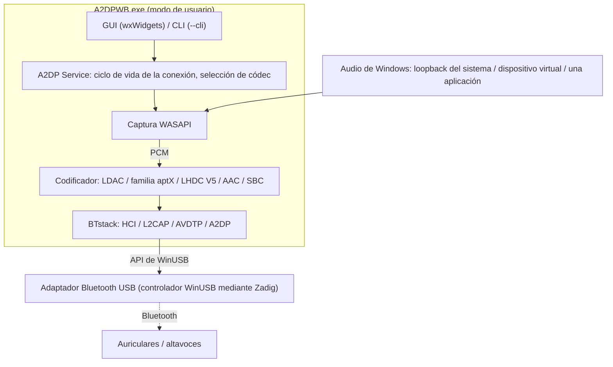
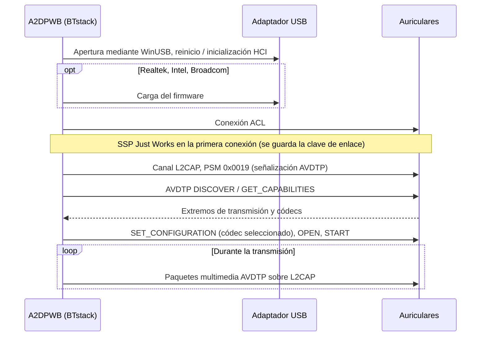
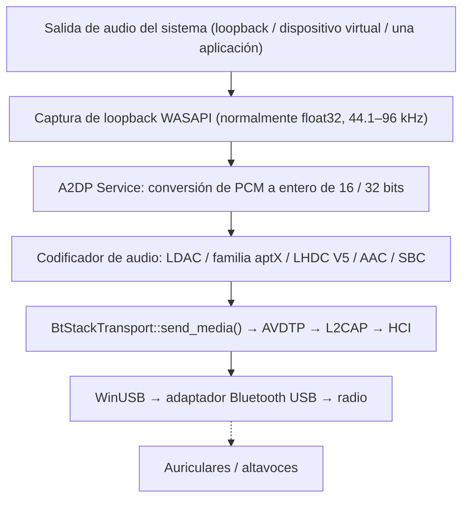
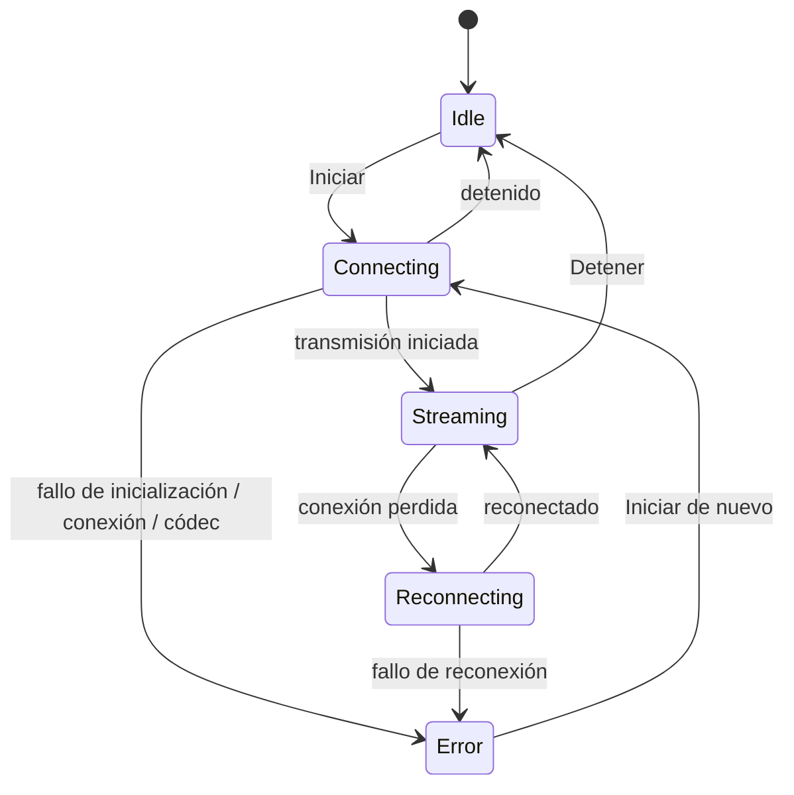

# Arquitectura
{: .no_toc }

## Contenido
{: .no_toc .text-delta }

1. TOC
{:toc}

---

## Descripción general

A2DP Windows Bridge (A2DPWB) habilita el audio Bluetooth LDAC, aptX HD, aptX Low Latency, aptX,
AAC y SBC en Windows. La pila Bluetooth propia de Windows solo admite
SBC, aptX clásico y (solo en Windows 11) AAC para A2DP; esta herramienta añade LDAC, aptX HD y aptX
Low Latency sin necesidad de un controlador de kernel.

Usa **BTstack + WinUSB**: todo en modo de usuario, sin necesidad de firmar controladores.



## Por qué la instalación requiere estos pasos

Con un controlador de audio propio, A2DPWB se instalaría como cualquier aplicación: los auriculares aparecerían como un dispositivo de audio normal de Windows en el Bluetooth integrado. Pero Windows 10 / 11 solo carga controladores de modo kernel firmados a través de Microsoft, y esa firma exige un certificado de firma de código EV. Estos certificados cuestan unos 300–700 USD al año y por lo general solo se emiten a empresas registradas, algo que un proyecto individual no puede asumir. Por eso A2DPWB toma el camino largo: retira a Windows un adaptador Bluetooth USB completo con el controlador WinUSB firmado por Microsoft y ejecuta él mismo la pila Bluetooth en modo usuario. Por eso se necesitan un adaptador dedicado, Zadig y (en los adaptadores Realtek) archivos de firmware.

Si solo quiere que sea sencillo, existe software de pago que incluye un controlador firmado y funciona con el Bluetooth integrado. Sinceramente, para lo que hace es notablemente barato, así que si lo que más le importa es una instalación sencilla, use ese en su lugar.

## Transporte: BTstack + WinUSB

Omite por completo la pila Bluetooth de Windows comunicándose directamente con un
adaptador Bluetooth USB mediante WinUSB (controlador USB genérico firmado por Microsoft). BTstack,
una pila Bluetooth de código disponible (licencia no comercial), implementa HCI, L2CAP, AVDTP y A2DP en
modo de usuario.

**Ventajas**:
- Sin coste de firma de controladores
- No requiere el modo de firma de prueba
- No hay que desactivar el Arranque seguro
- Todo el código se ejecuta en modo de usuario (depuración más sencilla)

**Inconvenientes**:
- Requiere un adaptador Bluetooth USB dedicado (aparte del Bluetooth integrado
  de Windows)
- Mientras WinUSB lo controla, el adaptador no está disponible para el Bluetooth
  normal de Windows
- La dirección del dispositivo se escribe a mano, se elige de la lista de
  dispositivos emparejados de Windows (leída mediante el adaptador integrado) o se
  encuentra con una búsqueda (GAP inquiry) con el adaptador USB

**Cómo funciona**:
1. El usuario instala el controlador WinUSB en un adaptador Bluetooth USB mediante Zadig
2. BTstack abre el dispositivo USB mediante la API de WinUSB
3. BTstack envía comandos HCI para inicializar el controlador Bluetooth
4. (Adaptadores Realtek, Intel y Broadcom) Se carga el firmware si es necesario
5. BTstack establece una conexión ACL y abre canales L2CAP (PSM 0x0019)
6. La señalización AVDTP descubre los SEP remotos y negocia los códecs
7. El audio codificado se envía como paquetes multimedia AVDTP sobre L2CAP



## Estructura de módulos

```
A2DPWB.exe
├── Capa de GUI (wxWidgets)
│   ├── wx_app              Punto de entrada de la aplicación, bucle de eventos
│   ├── wx_main_frame       Ventana principal (dispositivo, códec, estado)
│   ├── wx_profile_dialog   Gestión de perfiles de conexión, búsqueda de dispositivos
│   ├── wx_firmware_dialog  Descarga del firmware de Realtek
│   ├── wx_about_dialog     Acerca de / información de licencias
│   ├── wx_zadig_dialog     Guía de instalación de WinUSB con Zadig
│   ├── wx_link_quality_dialog  Ventana de calidad del enlace (lo que se envía, radio)
│   ├── wx_receiver_dialog  Prueba con receptor par (enviado frente a recibido, modo de depuración)
│   ├── wx_debug_console_dialog  Consola de depuración: registro en directo, flujo de conexión
│   ├── wx_radio_text.h     RSSI / AFH como texto para ambas ventanas
│   ├── theme_manager       Compatibilidad con tema claro / oscuro
│   └── localization        i18n (en, ja, zh-CN, zh-TW, ko, de, fr, es — JSON incrustado)
│
├── Capa principal
│   ├── a2dp_service        Ciclo de vida de la conexión A2DP y máquina de estados
│   ├── btstack_transport   Integración con BTstack (HCI, L2CAP, AVDTP, A2DP)
│   ├── btstack_link_key_db_file  Almacenamiento de claves de enlace (archivo en la carpeta de configuración)
│   ├── btstack_uart_tcp_windows  H4 por TCP hacia un controlador virtual (--hci-tcp, pruebas)
│   ├── wasapi_capture      Captura de audio por loopback WASAPI
│   ├── test_tone           Tono de prueba en lugar del audio capturado
│   ├── audio_encoder       Interfaz del codificador (clase base abstracta)
│   │   ├── ldac_encoder        LDAC (libldac, compatible con ABR)
│   │   ├── aptxhd_encoder      aptX HD (libopenaptx)
│   │   ├── aptxll_encoder      aptX Low Latency (libopenaptx)
│   │   ├── aptx_encoder        aptX clásico (libopenaptx)
│   │   ├── aptx_pcm_pack.h     Utilidad compartida PCM → 24 bits empaquetado para los codificadores aptX
│   │   ├── aac_encoder         AAC-LC (fdk-aac, transporte LATM)
│   │   └── a2dp_sbc_encoder    SBC (Bluedroid de BTstack)
│   │
│   ├── bt_device           Información del dispositivo Bluetooth (dirección, nombre, códecs)
│   ├── bt_adapter_enum     Enumeración de adaptadores Bluetooth USB (WinUSB)
│   ├── audio_device_enum   Enumeración de dispositivos de audio WASAPI
│   ├── profile_manager     Persistencia de perfiles de conexión (JSON)
│   ├── media_payload_limit Tamaño máximo del paquete multimedia (rango, predeterminado)
│   ├── afh                 Clasificación de canales AFH del host a partir de la búsqueda de Wi-Fi
│   ├── link_stats          Contadores para la ventana de calidad del enlace
│   └── remote_sink_client  Estadísticas de tools/linux_sink por la red
│
├── Soporte
│   ├── app_settings        Configuración persistente de la aplicación (JSON)
│   ├── config_path         Resolución de la ruta del archivo de configuración
│   ├── system_integration  Bandeja del sistema, inicio automático
│   ├── debug_log           Macros de registro de depuración
│   ├── debug_log_model     Líneas de registro y flujo de conexión para la consola de depuración
│   ├── hci_capture         Captura HCI bajo demanda (.pklg)
│   ├── update_checker      Búsqueda de actualizaciones (GitHub Releases)
│   ├── zadig_helper        Descarga / inicio de Zadig
│   ├── embedded_langs      Archivos de idioma incrustados al compilar
│   └── capture_mode        Definiciones de los modos de captura de audio
│
└── Modo CLI
    └── main.cpp            Análisis de argumentos de la CLI, transmisión sin interfaz
```

## Flujo de datos



## Módulos clave

### A2DP Service (`a2dp_service.cpp`)

Gestor central del ciclo de vida de la conexión. Coordina:
- La negociación del códec (selección automática o indicada por el usuario)
- El registro de extremos de transmisión para todos los códecs compatibles
- La selección de la frecuencia de muestreo de la familia aptX (44.1 / 48 kHz entre las que
  anuncia el dispositivo remoto; WASAPI remuestrea la captura)
- La conversión de PCM (float32 → entero de 16 / 32 bits) para el codificador
- La máquina de estados de la conexión (inactivo → conectando → transmitiendo → reconectando, error)
- La lógica de reconexión automática ante una desconexión inesperada
- El envío de paquetes multimedia con el empaquetado específico de cada códec

La máquina de estados de la conexión (`A2dpService::State`):



### BTstack Transport (`btstack_transport.cpp`)

Puente entre el modelo síncrono de la aplicación y la API orientada a eventos
de BTstack.

**Responsabilidades**:
- Inicializar BTstack con el transporte HCI de WinUSB
- Ejecutar el bucle de eventos de BTstack en un hilo dedicado
- Registrar los extremos de transmisión: códecs de fabricante (LDAC, aptX HD, aptX, aptX LL)
  además de SBC y AAC
- Registrar los registros SDP (A2DP Source, AVRCP Controller, AVRCP Target)
- Analizar las capacidades remotas, incluido aptX LL con ambos Vendor ID y
  aptX Adaptive (solo se detecta y se registra)
- Gestionar el ciclo de vida de la conexión A2DP mediante envoltorios de asíncrono a síncrono
- Gestionar el emparejamiento SSP (Just Works, General Bonding; claves de enlace persistentes)
- Cerrar una conexión semiabierta tras un tiempo de espera de conexión, para que los reintentos funcionen
- Reintentar una conexión fallida (hasta 3 intentos) y distinguir las causas (sin
  respuesta, enlace sin datos, el remoto cerró el enlace, autenticación); descartar una clave de enlace
  que el dispositivo ya no reconoce y volver a emparejar
- GAP inquiry para la búsqueda de dispositivos
- Clasificación de canales AFH del host y lecturas de RSSI / AFH para la ventana
  de calidad del enlace
- Ofrecer un envío multimedia seguro entre hilos para la devolución de llamada de WASAPI
- Carga de firmware para chipsets Realtek, Intel y Broadcom

**API clave de BTstack utilizadas**:
- `a2dp_source_create_stream_endpoint()` — Registrar los extremos de códec
- `a2dp_source_establish_stream()` — Conectar con el receptor A2DP
- `a2dp_source_set_config_other()` — Configurar un códec específico del fabricante
- `a2dp_source_stream_send_media_payload_rtp()` — Enviar audio codificado con
  encabezado RTP (LDAC, aptX HD, AAC, SBC)
- `a2dp_source_stream_send_media_packet()` — Enviar paquetes multimedia sin procesar, sin
  encabezado RTP (aptX, aptX LL)

### WASAPI Capture (`wasapi_capture.cpp`)

Captura en tiempo real la salida de audio del sistema mediante Windows Audio Session API.
- Usa `IAudioClient` en modo `AUDCLNT_STREAMFLAGS_LOOPBACK`
- Entrega el formato de mezcla del modo compartido del dispositivo (normalmente float32; A2DP Service
  lo convierte para el codificador)
- Selección configurable del dispositivo de audio

### Codificadores de audio

| Codificador | Biblioteca | Tasa de bits | Características |
|---------|---------|---------|----------|
| LDAC | libldac (AOSP) | 330/660/990 kbps | Modos HQ/SQ/MQ, ABR |
| aptX HD | libopenaptx | 576 kbps | Entrada de 24 bits, tasa fija, encabezado RTP |
| aptX LL | libopenaptx | 352 kbps | Latencia de ~32 ms, sin encabezado RTP, paquetes ≤ ~7.5 ms |
| aptX | libopenaptx | 352/384 kbps (44.1/48 kHz) | Estéreo de 16 bits, sin encabezado RTP |
| AAC | fdk-aac | hasta 256 kbps | AAC-LC, transporte LATM |
| SBC | Bluedroid de BTstack | hasta ~345 kbps | Base obligatoria de A2DP |
| LHDC V5 | lhdcv5-enc (port en C del codificador de AOSP) | 400/500/900/1000 kbps, ABR 160–400 kbps | Experimental; 16/24 bits, tramas de 5 ms, encabezado de carga útil multimedia de 2 bytes, encabezado RTP |

Todos los codificadores implementan la interfaz `AudioEncoder` con los métodos `encode()` y
`get_frame_size()`.

libopenaptx espera grupos de 4 muestras estéreo como PCM de 24 bits empaquetado
little-endian. `aptx_pcm_pack.h` convierte las muestras de 16 o 32 bits (alineadas al MSB) de la captura
a ese formato para los codificadores aptX, aptX HD y aptX LL; la entrada mono
se duplica en ambos canales.

## Elementos de información de códecs de fabricante

Los códecs no estándar se registran como Vendor Specific en AVDTP:

| Códec | Vendor ID | Codec ID |
|-------|-----------|----------|
| LDAC | Sony (0x0000012D) | 0x00AA |
| aptX | APT (0x0000004F) | 0x0001 |
| aptX HD | Qualcomm (0x000000D7) | 0x0024 |
| aptX Low Latency | CSR (0x0000000A) o Qualcomm (0x000000D7) | 0x0002 |
| aptX Adaptive | Qualcomm (0x000000D7) | 0x00AD (solo se detecta, nunca se selecciona) |
| LHDC V5 | Savitech (0x0000053A) | 0x4C35 |

AAC y SBC usan los Codec ID estándar de A2DP definidos en la especificación de A2DP.

Tamaños de los elementos de información de códec (incluidos los 6 bytes de Vendor ID/Codec ID):

- **aptX**: 7 bytes (byte 6 = frecuencia de muestreo / modo de canal)
- **aptX HD**: 11 bytes (byte 6 como en aptX, más 4 bytes reservados); se requiere
  estéreo
- **aptX LL**: 8 bytes, o 17 bytes cuando el receptor activa el indicador extendido
  («new caps»). A2DPWB registra un único extremo aptX LL y configura el
  flujo con el Vendor ID que usó el receptor
- **LHDC V5**: 11 bytes (`a2dp_vendor_lhdcv5_constants.h` de Android): byte 6
  frecuencias de muestreo (0x20 44.1k, 0x10 48k, 0x04 96k, 0x01 192k), byte 7 profundidad de bits
  (0x04 16 bits, 0x02 24 bits) y los límites mínimo/máximo de tasa de bits del receptor, byte 8
  subversión del códec (0x01 = V5 ver.1) y 0x10 = tramas de 5 ms, bytes 9-10
  funciones opcionales (baja latencia, sin pérdida, JAS, AR, META), ninguna de las cuales
  ofrece A2DPWB. Solo estéreo. Los límites de tasa de bits del receptor se devuelven en la
  configuración y se aplican al codificador, como hace Android. Los paquetes multimedia
  llevan un encabezado de carga útil de 2 bytes: número de tramas << 2 (bits de latencia 0) y un
  número de secuencia

**Con o sin RTP**: los paquetes multimedia de LDAC, aptX HD, AAC, SBC y LHDC V5 llevan el
encabezado RTP de 12 bytes. aptX y aptX LL se envían **sin** encabezado RTP (como hacen Android y
PipeWire), de modo que toda la MTU de L2CAP queda disponible para las tramas aptX.

**aptX Adaptive** no tiene codificador de código abierto (libopenaptx no lo
implementa), así que A2DPWB nunca lo registra ni lo selecciona. Cuando un receptor lo ofrece, A2DPWB
solo lo registra en el log; se usa aptX clásico si el receptor lo ofrece por separado.

## Sistema de compilación

- **CMake** con MSVC (Visual Studio 2022 o posterior)
- Bibliotecas de terceros compiladas como bibliotecas estáticas desde el código fuente
- wxWidgets se descarga durante la configuración mediante CMake FetchContent (v3.2.6)
- Archivos de idioma (JSON) incrustados en el ejecutable durante la configuración
- Manifiesto e icono de la aplicación compilados mediante un script de recursos de Windows

## Consideraciones importantes

- **Compatibilidad de adaptadores**: adaptadores USB Realtek (los más probados) y CSR; Intel y
  Broadcom son experimentales. Los adaptadores Realtek necesitan cargar el firmware al iniciar,
  y también los Intel en modo bootloader
- **Emparejamiento**: usa SSP Just Works con General Bonding. Las claves de enlace se guardan
  en un archivo local
- **Se recomienda un segundo adaptador**: mantenga el Bluetooth integrado para Windows y use
  un adaptador USB dedicado para A2DPWB
- El firmware de algunos adaptadores Bluetooth limita la tasa de bits alcanzable
- Por lo general, los adaptadores USB Bluetooth 5.0+ funcionan bien con LDAC
- Prioridad de la selección automática de códec: LDAC > aptX HD > aptX LL > aptX > LHDC V5 (experimental) > AAC > SBC
