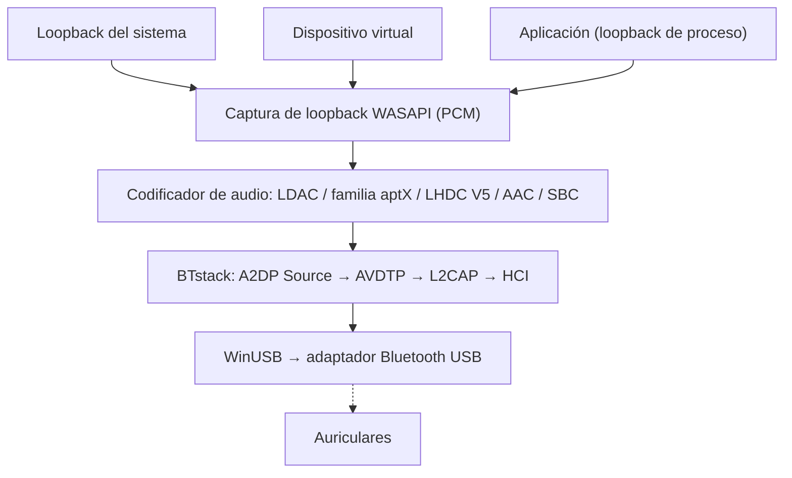

# A2DP Windows Bridge (A2DPWB)

Transmisión de audio Bluetooth A2DP para Windows con compatibilidad completa de códecs.
{: .fs-6 .fw-300 }

Transmite el audio del sistema mediante **LDAC, aptX HD, aptX Low Latency, aptX, AAC, SBC** y **LHDC V5** con un adaptador Bluetooth USB en modo WinUSB, sin controlador de kernel ni firma de prueba.

[Primeros pasos](setup){: .btn .btn-primary .fs-5 .mb-4 .mb-md-0 .mr-2 }
[GitHub](https://github.com/SeiyaFunaokaJP/A2DP-Windows-Bridge){: .btn .fs-5 .mb-4 .mb-md-0 }

---

## Códecs compatibles

| Códec | Tasa de bits | Frecuencia de muestreo | Profundidad de bits | Latencia |
|:------|:--------|:------------|:----------|:--------|
| LDAC | 330/660/990 kbps | 44.1--96 kHz | 16/24/32 bits | ~200 ms |
| aptX HD | 576 kbps | 44.1/48 kHz | 24 bits | ~150 ms |
| aptX Low Latency | 352 kbps | 44.1/48 kHz | 16 bits | ~32 ms |
| aptX | 352/384 kbps | 44.1/48 kHz | 16 bits | -- |
| AAC | 128/192/256 kbps | 44.1/48 kHz | 16 bits | ~150 ms |
| SBC | hasta ~345 kbps | 44.1/48 kHz | 16 bits | ~150 ms |
| LHDC V5 | 400/500/900/1000 kbps, ABR 160--400 kbps | 44.1/48/96/192 kHz | 16/24 bits | -- |

### Compatibilidad de códecs por plataforma (envío a los auriculares)

| Códec | Windows 10 integrado | Windows 11 integrado | Ubuntu integrado (PipeWire) | **A2DPWB** (Windows 10 / 11) |
|:------|:-------------------:|:-------------------:|:--------------------------:|:----------------------------:|
| LDAC | ❌ | ❌ | ✅ | ✅ |
| aptX HD | ❌ | ❌ | ✅ | 🧪 experimental |
| aptX Low Latency | ❌ | ❌ | ✅ | 🧪 experimental |
| aptX | ✅ | ✅ | ✅ | ✅ |
| AAC | ❌ | ✅ | ❌ no está en los paquetes de Ubuntu | ✅ |
| SBC | ✅ | ✅ | ✅ | ✅ |
| LHDC V5 | ❌ | ❌ | ❌ | ✅ |
| aptX Adaptive | ❌ | ❌ | ❌ | ❌ |

✅ compatible · 🧪 experimental · ❌ no compatible. Todas las columnas corresponden al lado emisor (PC → auriculares). «Integrado» es el audio Bluetooth propio del sistema operativo, sin A2DPWB; la columna de Ubuntu es el conjunto de códecs de PipeWire en Ubuntu 26.04 (`libspa-0.2-bluetooth`).

{: .warning }
**aptX HD y aptX Low Latency son experimentales.** Siguen las implementaciones de Android / PipeWire y superan las pruebas de ida y vuelta de codificación/decodificación, pero aún no se han verificado con auriculares reales. Los valores de latencia de esta tabla son cifras típicas, no medidas con A2DPWB.

{: .note }
**Acerca de LHDC V5.** Usa un port en C del codificador LHDC V5 que Google añadió a Android 17 (AOSP, Apache-2.0); se verificó que el port produce exactamente los mismos bits que el codificador en Rust de AOSP, y la señalización A2DP sigue `a2dp_vendor_lhdcv5` de Android. Un usuario lo verificó con auriculares LHDC V5 reales a 1000 kbps / 192 kHz ([#50](https://github.com/SeiyaFunaokaJP/A2DP-Windows-Bridge/issues/50)). Solo se admite LHDC V5 con pérdida: LHDC V2/V3 (auriculares más antiguos) y el modo sin pérdida «LHDC-RAW» no tienen codificador de código abierto. En modo Automático, LHDC V5 tiene menos prioridad que LDAC y la familia aptX, y más que AAC / SBC.

{: .note }
**¿Solo necesita aptX clásico?** Windows 10 ya admite aptX clásico en su pila Bluetooth integrada (no aptX HD, aptX LL ni aptX Adaptive), así que A2DPWB no es necesario para ese códec. A2DPWB es útil sobre todo para LDAC, aptX HD y aptX Low Latency.

{: .note }
**aptX Adaptive no es compatible** (no existe un codificador de código abierto). Si sus auriculares también ofrecen aptX clásico, A2DPWB usa aptX directamente; si no, Automático elige AAC o SBC. Consulte [Familia aptX y compatibilidad con aptX Adaptive](usage#aptx-compatibility).

## Compatibilidad de plataformas

| Componente | Windows 10 (x64) | Windows 11 (x64) | Linux (Ubuntu) |
|:----------|:----------------:|:----------------:|:--------------:|
| **A2DPWB** (GUI / CLI) | ✅ (aún no probado en hardware real) | ✅ | ❌ |
| [Compilación desde el código fuente](building) (Visual Studio 2022+) | ✅ | ✅ | ❌ |
| `a2dpwb_decode` (comprobador del flujo) | ✅ | ✅ | ❌ |
| Prueba de extremo a extremo `tools/emu/run_test.py` | ✅ | ✅ | ❌ |
| Adaptador virtual `tools/emu/emu_vhci.py` | ❌ | ❌ | ✅ |
| [Receptor de medición](usage#receiver) `tools/linux_sink` | ❌ | ❌ | ✅ |

A2DPWB solo funciona en Windows, como compilación x64. Las herramientas de Linux necesitan Python 3.11 o posterior (verificado en Ubuntu 26.04); `setup.sh` está pensado para Ubuntu / Debian; en otras distribuciones hay que instalar los paquetes a mano.

## Hardware verificado

| Qué | Configuración | Códecs | Resultado |
|:-----|:------|:-------|:-------|
| Sony WH-1000XM4 (auriculares) | Windows 11 + TP-Link UB500 | LDAC, AAC, SBC | ✅ Reproduce (los XM4 no tienen aptX) |
| TP-Link UB500 (Realtek RTL8761BU, adaptador) | Windows 11, WinUSB, linux-firmware `rtl8761bu` | – | ✅ |
| Receptor de medición `tools/linux_sink` | Windows 11 + UB500 → Ubuntu 26.04 por radio | SBC, AAC, aptX, aptX HD, aptX LL, LDAC | ✅ Recibido y medido |
| Enlace virtual `tools/emu` (Bumble) | Windows 11, sin radio | SBC, AAC, aptX, aptX HD, aptX LL, LDAC, LHDC V5 | ✅ La prueba de extremo a extremo se supera |
| Auriculares LHDC V5 (informe de un usuario, [#50](https://github.com/SeiyaFunaokaJP/A2DP-Windows-Bridge/issues/50)) | Windows + A2DPWB v1.1.1-beta.1 | LHDC V5 | ✅ Se reproduce a 1000 kbps / 192 kHz |

Windows 10 aún no se ha probado en hardware real. Otros adaptadores: consulte [Adaptadores recomendados](setup#adapters).

## Modos de captura de audio

A2DPWB captura el audio mediante WASAPI y ofrece tres modos:

| Modo | Descripción | Caso de uso |
|:-----|:------------|:---------|
| **Loopback del sistema** | Captura toda la salida de audio del sistema del dispositivo de reproducción predeterminado mediante loopback de WASAPI | Configuración sencilla: se transmiten todos los sonidos |
| **Dispositivo virtual** | Captura desde un dispositivo de audio virtual elegido por el usuario (p. ej., VB-CABLE, VoiceMeeter) | Enviar aplicaciones concretas a Bluetooth y mantener el resto del audio en los altavoces |
| **Aplicación** | Captura solo lo que reproduce una aplicación, después de su propio procesamiento (Windows 11 / Windows 10 2004+) | Enviar una aplicación, o la salida de una aplicación de efectos para todo el sistema (ecualizador, mejora de sonido) |

En el modo **Dispositivo virtual**, A2DPWB cambia el dispositivo de reproducción predeterminado de Windows al dispositivo virtual seleccionado y captura su salida de loopback. Las aplicaciones que reproducen en el dispositivo virtual se transmiten por Bluetooth. Al detener la transmisión, se restaura el dispositivo predeterminado anterior.

El Loopback del sistema no le quita el audio al dispositivo de reproducción predeterminado: se oye allí y también por Bluetooth. Consulte [Modos de captura](usage#capture-modes).

## Cómo funciona

A2DPWB omite por completo la pila Bluetooth de Windows. Se comunica directamente con un adaptador Bluetooth USB a través de WinUSB y usa [BTstack](https://github.com/bluekitchen/btstack) para implementar toda la pila de protocolos Bluetooth en modo de usuario.

## Funciones

- **Varios códecs**: LDAC, aptX HD, aptX Low Latency, aptX, AAC, SBC con negociación automática
- **Tres modos de captura**: loopback del sistema, enrutamiento a través de un dispositivo de audio virtual o la salida de una sola aplicación
- **ABR**: tasa de bits adaptativa para conexiones inestables (LDAC y LHDC V5)
- **Reconexión automática**: vuelve a conectar si se pierde la conexión (hasta 10 intentos)
- **Calidad del enlace y AFH**: muestra lo que se envía, el RSSI y los canales en uso; indica al adaptador qué canales Wi-Fi debe evitar (consulte [Uso](usage#link-quality))
- **Controles de los auriculares (AVRCP)**: control deslizante de volumen sincronizado con los auriculares y con el volumen de Windows; sus botones de reproducir/pausar, siguiente y anterior controlan la reproducción en el PC (consulte [Uso](usage#headphone-buttons))
- **Gestión de perfiles**: guarde y cargue configuraciones de dispositivo + códec
- **GUI + CLI**: interfaz gráfica con wxWidgets o uso por línea de comandos
- **Localización**: inglés, japonés, chino simplificado, chino tradicional, coreano, alemán, francés, español
- **Firmware de Realtek**: descarga guiada del firmware para adaptadores Realtek
- **Diagnóstico** (modo de depuración): consola de depuración, captura HCI, prueba con receptor par frente a un PC con Linux (consulte [Uso](usage#receiver))
