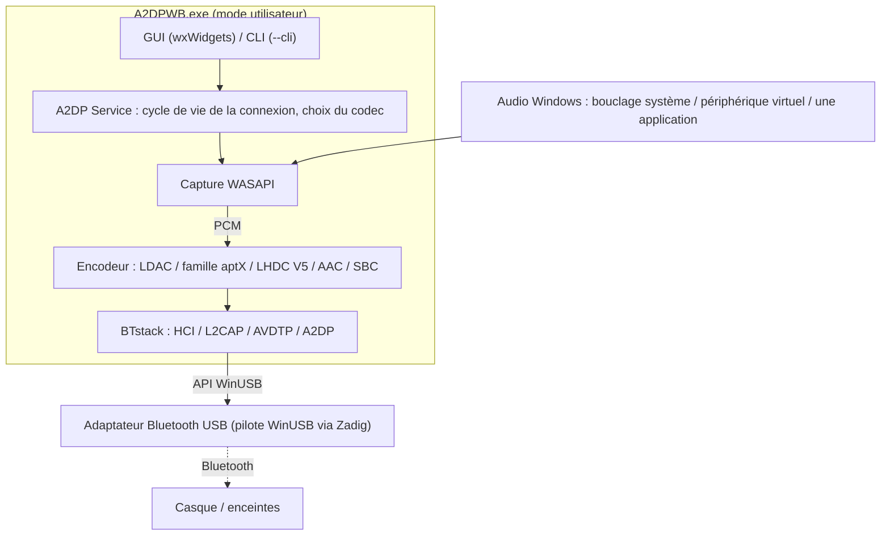
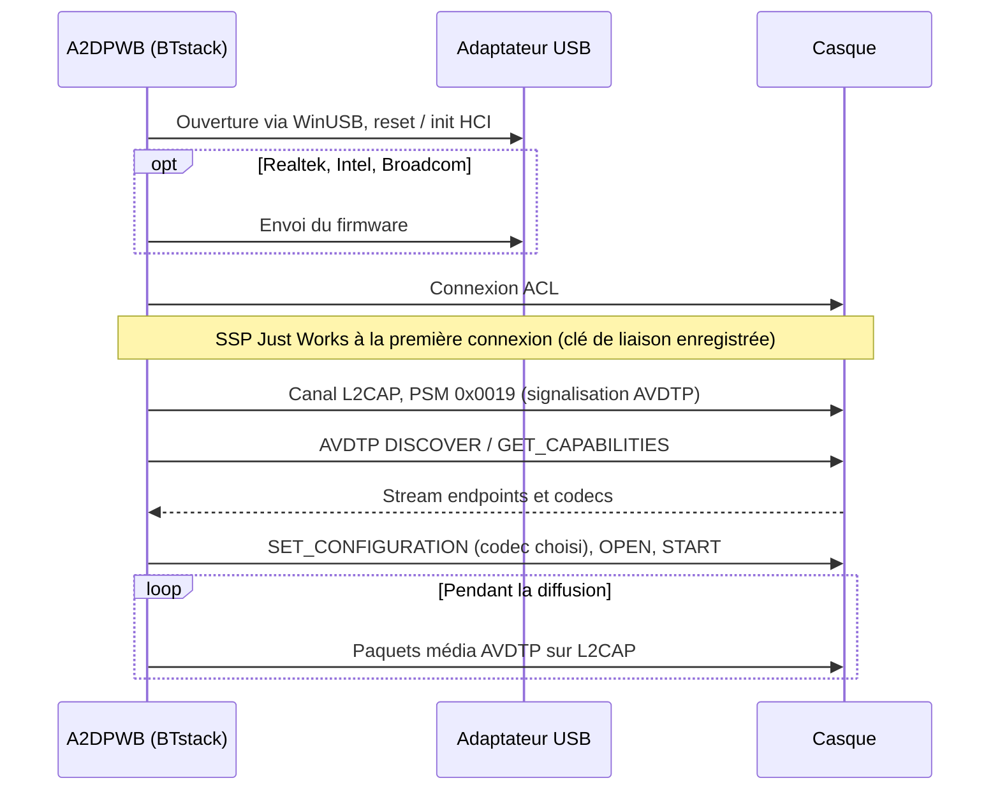
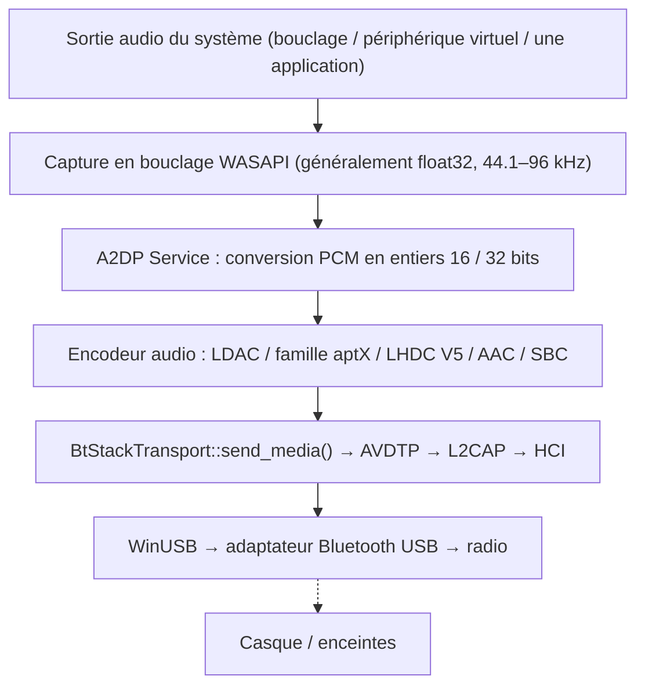
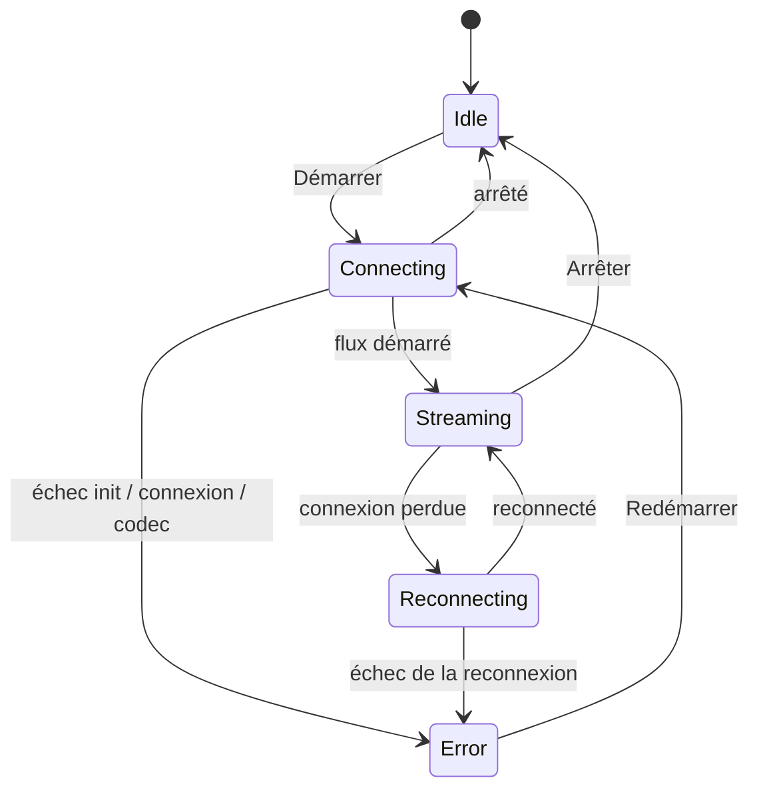

# Architecture
{: .no_toc }

## Table des matières
{: .no_toc .text-delta }

1. TOC
{:toc}

---

## Vue d'ensemble

A2DP Windows Bridge (A2DPWB) permet l'audio Bluetooth LDAC, aptX HD, aptX Low Latency, aptX,
AAC et SBC sous Windows. La pile Bluetooth propre à Windows ne prend en charge
que SBC, l'aptX classique et (Windows 11 uniquement) AAC pour A2DP — cet outil ajoute LDAC, aptX HD et aptX
Low Latency sans nécessiter de pilote noyau.

Utilise **BTstack + WinUSB** — entièrement en mode utilisateur, aucune signature de pilote nécessaire.



## Pourquoi la mise en place demande ces étapes

Avec son propre pilote audio, A2DPWB s'installerait comme n'importe quelle application : le casque apparaîtrait comme un périphérique audio Windows ordinaire sur le Bluetooth intégré. Mais Windows 10 / 11 ne charge que des pilotes noyau signés par l'intermédiaire de Microsoft, et cette signature exige un certificat de signature de code EV. Ces certificats coûtent environ 300 à 700 USD par an et ne sont en général délivrés qu'à des entreprises enregistrées — trop pour un projet individuel. A2DPWB prend donc le chemin détourné : il retire à Windows tout un adaptateur Bluetooth USB grâce au pilote WinUSB signé par Microsoft et exécute lui-même la pile Bluetooth en mode utilisateur. C'est pourquoi il faut un adaptateur dédié, Zadig et (pour les adaptateurs Realtek) des fichiers de firmware.

Si vous voulez simplement que ce soit facile, il existe un logiciel payant qui fournit un pilote signé et fonctionne avec le Bluetooth intégré. Honnêtement, pour ce qu'il fait, il est remarquablement bon marché : si la simplicité d'installation compte avant tout pour vous, utilisez-le plutôt.

## Transport : BTstack + WinUSB

Contourne entièrement la pile Bluetooth de Windows en communiquant directement avec un
adaptateur Bluetooth USB via WinUSB (pilote USB générique signé par Microsoft). BTstack,
une pile Bluetooth à code source disponible (licence non commerciale), implémente HCI, L2CAP, AVDTP et A2DP en
mode utilisateur.

**Avantages** :
- Aucun coût de signature de pilote
- Pas besoin du mode de signature de test
- Pas besoin de désactiver le Secure Boot
- Tout le code s'exécute en mode utilisateur (débogage plus facile)

**Contreparties** :
- Nécessite un adaptateur Bluetooth USB dédié (distinct du Bluetooth intégré
  de Windows)
- Tant qu'il est pris par WinUSB, l'adaptateur n'est pas disponible pour le
  Bluetooth habituel de Windows
- L'adresse de l'appareil est saisie à la main, choisie dans la liste des
  appareils associés de Windows (lue via l'adaptateur intégré), ou trouvée par
  une recherche (GAP inquiry) avec l'adaptateur USB

**Fonctionnement** :
1. L'utilisateur installe le pilote WinUSB sur un adaptateur Bluetooth USB via Zadig
2. BTstack ouvre le périphérique USB via l'API WinUSB
3. BTstack envoie des commandes HCI pour initialiser le contrôleur Bluetooth
4. (Adaptateurs Realtek, Intel et Broadcom) Le firmware est envoyé si nécessaire
5. BTstack établit une connexion ACL et ouvre des canaux L2CAP (PSM 0x0019)
6. La signalisation AVDTP découvre les SEP distants et négocie les codecs
7. L'audio encodé est envoyé sous forme de paquets média AVDTP sur L2CAP



## Structure des modules

```
A2DPWB.exe
├── GUI Layer (wxWidgets)
│   ├── wx_app              App entry point, event loop
│   ├── wx_main_frame       Main window (device, codec, status)
│   ├── wx_profile_dialog   Connection profile management, device scan
│   ├── wx_firmware_dialog  Realtek firmware download
│   ├── wx_about_dialog     About / license info
│   ├── wx_zadig_dialog     Zadig WinUSB installation guide
│   ├── wx_link_quality_dialog  Link quality window (what is sent, radio)
│   ├── wx_receiver_dialog  Peer receiver test (sent vs. received, debug mode)
│   ├── wx_debug_console_dialog  Debug console: live log, connection flow
│   ├── wx_radio_text.h     RSSI / AFH as text for both windows
│   ├── theme_manager       Light / dark theme support
│   └── localization        i18n (en, ja, zh-CN, zh-TW, ko, de, fr, es — embedded JSON)
│
├── Core Layer
│   ├── a2dp_service        A2DP connection lifecycle & state machine
│   ├── btstack_transport   BTstack integration (HCI, L2CAP, AVDTP, A2DP)
│   ├── btstack_link_key_db_file  Link key storage (file in the config folder)
│   ├── btstack_uart_tcp_windows  H4 over TCP to a virtual controller (--hci-tcp, testing)
│   ├── wasapi_capture      WASAPI loopback audio capture
│   ├── test_tone           Test tone instead of captured audio
│   ├── audio_encoder       Encoder interface (abstract base)
│   │   ├── ldac_encoder        LDAC (libldac, ABR support)
│   │   ├── aptxhd_encoder      aptX HD (libopenaptx)
│   │   ├── aptxll_encoder      aptX Low Latency (libopenaptx)
│   │   ├── aptx_encoder        aptX classic (libopenaptx)
│   │   ├── aptx_pcm_pack.h     Shared PCM → packed 24-bit helper for aptX encoders
│   │   ├── aac_encoder         AAC-LC (fdk-aac, LATM transport)
│   │   └── a2dp_sbc_encoder    SBC (BTstack Bluedroid)
│   │
│   ├── bt_device           Bluetooth device info (address, name, codecs)
│   ├── bt_adapter_enum     USB Bluetooth adapter enumeration (WinUSB)
│   ├── audio_device_enum   WASAPI audio device enumeration
│   ├── profile_manager     Connection profile persistence (JSON)
│   ├── media_payload_limit Max media packet size (range, default)
│   ├── afh                 AFH host channel classification from the Wi-Fi scan
│   ├── link_stats          Counters for the link quality window
│   └── remote_sink_client  Statistics from tools/linux_sink over the network
│
├── Support
│   ├── app_settings        Persistent application settings (JSON)
│   ├── config_path         Config file path resolution
│   ├── system_integration  System tray, autostart
│   ├── debug_log           Debug logging macros
│   ├── debug_log_model     Log lines and connection flow for the debug console
│   ├── hci_capture         On-demand HCI capture (.pklg)
│   ├── update_checker      Update check (GitHub Releases)
│   ├── zadig_helper        Zadig download / launch
│   ├── embedded_langs      Language files embedded at build time
│   └── capture_mode        Audio capture mode definitions
│
└── CLI Mode
    └── main.cpp            CLI argument parsing, headless streaming
```

## Flux de données



## Modules principaux

### A2DP Service (`a2dp_service.cpp`)

Gestionnaire central du cycle de vie de la connexion. Coordonne :
- La négociation du codec (choix automatique ou choisi par l'utilisateur)
- L'enregistrement des stream endpoints pour tous les codecs pris en charge
- Le choix de la fréquence d'échantillonnage pour la famille aptX (44,1 / 48 kHz
  parmi les fréquences annoncées par l'appareil distant ; WASAPI rééchantillonne la capture)
- La conversion PCM (float32 → entiers 16 / 32 bits) pour l'encodeur
- La machine à états de la connexion (idle → connecting → streaming → reconnecting, error)
- La logique de reconnexion automatique en cas de déconnexion inattendue
- L'envoi des paquets média avec le découpage en trames propre à chaque codec

La machine à états de la connexion (`A2dpService::State`) :



### BTstack Transport (`btstack_transport.cpp`)

Pont entre le modèle synchrone de l'application et l'API événementielle de
BTstack.

**Responsabilités** :
- Initialiser BTstack avec le transport HCI WinUSB
- Exécuter la boucle d'événements de BTstack dans un thread dédié
- Enregistrer les stream endpoints : codecs constructeur (LDAC, aptX HD, aptX, aptX LL)
  plus SBC et AAC
- Enregistrer les enregistrements SDP (A2DP Source, AVRCP Controller, AVRCP Target)
- Analyser les capacités distantes, y compris l'aptX LL sous ses deux Vendor IDs et
  l'aptX Adaptive (seulement détecté et journalisé)
- Gérer le cycle de vie de la connexion A2DP via des enveloppes asynchrone-vers-synchrone
- Gérer l'association SSP (Just Works, General Bonding ; clés de liaison conservées)
- Fermer une connexion à moitié ouverte après un délai de connexion dépassé, pour que les nouvelles tentatives fonctionnent
- Retenter une connexion échouée (jusqu'à 3 tentatives) et distinguer les causes (pas de
  réponse, liaison muette, liaison fermée par l'appareil distant, authentification) ; supprimer une clé de liaison
  que l'appareil ne connaît plus et refaire l'association
- GAP inquiry pour la recherche d'appareils
- Classification des canaux AFH par l'hôte et lectures RSSI / AFH pour la fenêtre
  Qualité de liaison
- Fournir un envoi média thread-safe pour le callback WASAPI
- Chargement du firmware pour les puces Realtek, Intel et Broadcom

**Principales API BTstack utilisées** :
- `a2dp_source_create_stream_endpoint()` — Enregistrer les endpoints des codecs
- `a2dp_source_establish_stream()` — Se connecter au récepteur A2DP
- `a2dp_source_set_config_other()` — Configurer un codec propre à un constructeur
- `a2dp_source_stream_send_media_payload_rtp()` — Envoyer l'audio encodé avec un
  en-tête RTP (LDAC, aptX HD, AAC, SBC)
- `a2dp_source_stream_send_media_packet()` — Envoyer des paquets média bruts sans
  en-tête RTP (aptX, aptX LL)

### Capture WASAPI (`wasapi_capture.cpp`)

Capture la sortie audio du système en temps réel via Windows Audio Session API.
- Utilise `IAudioClient` en mode `AUDCLNT_STREAMFLAGS_LOOPBACK`
- Fournit le format de mixage du mode partagé du périphérique (généralement float32 ; A2DP Service
  le convertit pour l'encodeur)
- Choix du périphérique audio configurable

### Encodeurs audio

| Encodeur | Bibliothèque | Débit | Caractéristiques |
|---------|---------|---------|----------|
| LDAC | libldac (AOSP) | 330/660/990 kbps | Modes HQ/SQ/MQ, ABR |
| aptX HD | libopenaptx | 576 kbps | Entrée 24 bits, débit fixe, en-tête RTP |
| aptX LL | libopenaptx | 352 kbps | Latence ~32 ms, sans en-tête RTP, paquets ≤ ~7,5 ms |
| aptX | libopenaptx | 352/384 kbps (44.1/48 kHz) | Stéréo 16 bits, sans en-tête RTP |
| AAC | fdk-aac | jusqu'à 256 kbps | AAC-LC, transport LATM |
| SBC | BTstack Bluedroid | jusqu'à ~345 kbps | Base A2DP obligatoire |
| LHDC V5 | lhdcv5-enc (portage en C de l'encodeur AOSP) | 400/500/900/1000 kbps, ABR 160–400 kbps | 16/24 bits, trames de 5 ms, en-tête de charge utile média de 2 octets, en-tête RTP |

Tous les encodeurs implémentent l'interface `AudioEncoder` avec les méthodes `encode()` et
`get_frame_size()`.

libopenaptx attend des groupes de 4 échantillons stéréo en PCM 24 bits little-endian
compacté. `aptx_pcm_pack.h` convertit les échantillons 16 bits ou 32 bits (alignés sur le MSB)
de la capture dans ce format pour les encodeurs aptX, aptX HD et aptX LL ; une entrée mono
est dupliquée sur les deux canaux.

## Information Elements des codecs constructeur

Les codecs non standard sont enregistrés comme Vendor Specific dans AVDTP :

| Codec | Vendor ID | Codec ID |
|-------|-----------|----------|
| LDAC | Sony (0x0000012D) | 0x00AA |
| aptX | APT (0x0000004F) | 0x0001 |
| aptX HD | Qualcomm (0x000000D7) | 0x0024 |
| aptX Low Latency | CSR (0x0000000A) ou Qualcomm (0x000000D7) | 0x0002 |
| aptX Adaptive | Qualcomm (0x000000D7) | 0x00AD (seulement détecté, jamais choisi) |
| LHDC V5 | Savitech (0x0000053A) | 0x4C35 |

AAC et SBC utilisent les Codec IDs A2DP standard définis dans la spécification A2DP.

Tailles des Information Elements des codecs (y compris les 6 octets de Vendor ID/Codec ID) :

- **aptX** : 7 octets (octet 6 = fréquence d'échantillonnage / mode de canal)
- **aptX HD** : 11 octets (octet 6 comme pour l'aptX, plus 4 octets réservés) ; la stéréo est
  obligatoire
- **aptX LL** : 8 octets, ou 17 octets lorsque le récepteur active l'indicateur étendu
  (« new caps »). A2DPWB enregistre un seul endpoint aptX LL et configure le
  flux avec le Vendor ID utilisé par le récepteur
- **LHDC V5** : 11 octets (Android `a2dp_vendor_lhdcv5_constants.h`) : octet 6
  fréquences d'échantillonnage (0x20 44.1k, 0x10 48k, 0x04 96k, 0x01 192k), octet 7 profondeur de bits
  (0x04 16 bits, 0x02 24 bits) et limites de débit min/max du récepteur, octet 8
  sous-version du codec (0x01 = V5 ver.1) et 0x10 = trames de 5 ms, octets 9-10
  fonctions optionnelles (low latency, lossless, JAS, AR, META), dont aucune
  n'est proposée par A2DPWB. Stéréo uniquement. Les limites de débit du récepteur sont renvoyées dans la
  configuration et appliquées à l'encodeur, comme le fait Android. Les paquets média
  portent un en-tête de charge utile de 2 octets : nombre de trames << 2 (bits de latence à 0) et un
  numéro de séquence

**RTP ou non** : les paquets média LDAC, aptX HD, AAC, SBC et LHDC V5 portent
l'en-tête RTP de 12 octets. aptX et aptX LL sont envoyés **sans** en-tête RTP (comme le font Android et
PipeWire), si bien que toute la MTU L2CAP est disponible pour les trames aptX.

**aptX Adaptive** n'a pas d'encodeur open source (libopenaptx ne l'implémente
pas) : A2DPWB ne l'enregistre et ne le choisit donc jamais. Lorsqu'un récepteur le propose, A2DPWB
se contente de le journaliser ; l'aptX classique est utilisé si le récepteur le propose séparément.

## Système de compilation

- **CMake** avec MSVC (Visual Studio 2022 ou ultérieur)
- Bibliothèques tierces compilées en bibliothèques statiques depuis les sources
- wxWidgets récupéré lors de la configuration via CMake FetchContent (v3.2.6)
- Fichiers de langue (JSON) intégrés à l'exécutable lors de la configuration
- Manifeste de l'application et icône compilés via un script de ressources Windows

## Points importants

- **Compatibilité des adaptateurs** : adaptateurs USB Realtek (les mieux testés) et CSR ; Intel et
  Broadcom sont expérimentaux. Les adaptateurs Realtek nécessitent l'envoi du firmware au démarrage,
  les adaptateurs Intel en mode bootloader aussi
- **Association** : utilise SSP Just Works avec General Bonding. Les clés de liaison sont conservées
  dans un fichier local
- **Second adaptateur recommandé** : gardez le Bluetooth intégré pour Windows, utilisez
  un adaptateur USB dédié pour A2DPWB
- Le firmware de certains adaptateurs Bluetooth limite le débit atteignable
- Les adaptateurs Bluetooth USB 5.0+ fonctionnent généralement bien pour LDAC
- Priorité du choix automatique du codec : LDAC > aptX HD > aptX LL > aptX > LHDC V5 > AAC > SBC
