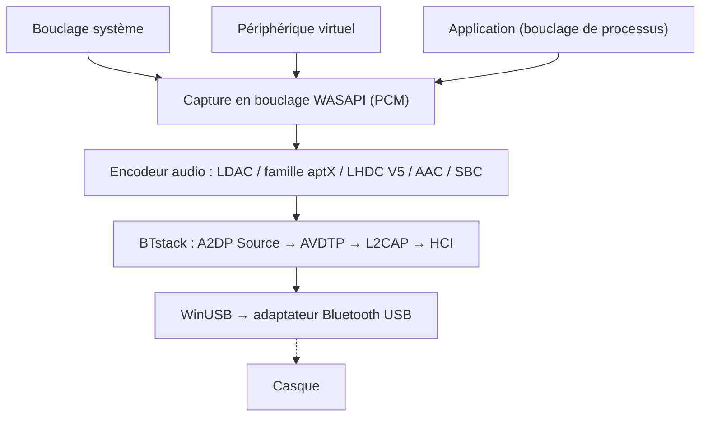

# A2DP Windows Bridge (A2DPWB)

Diffusion audio Bluetooth A2DP pour Windows, avec tous les codecs.
{: .fs-6 .fw-300 }

Diffuse l'audio du système en **LDAC, aptX HD, aptX Low Latency, aptX, AAC, SBC** et (à titre expérimental) **LHDC V5** grâce à un adaptateur Bluetooth USB en mode WinUSB -- sans pilote noyau ni signature de test.

[Commencer](setup){: .btn .btn-primary .fs-5 .mb-4 .mb-md-0 .mr-2 }
[GitHub](https://github.com/SeiyaFunaokaJP/A2DP-Windows-Bridge){: .btn .fs-5 .mb-4 .mb-md-0 }

---

## Codecs pris en charge

| Codec | Débit | Fréquence d'échantillonnage | Profondeur de bits | Latence |
|:------|:--------|:------------|:----------|:--------|
| LDAC | 330/660/990 kbps | 44.1--96 kHz | 16/24/32 bit | ~200 ms |
| aptX HD | 576 kbps | 44.1/48 kHz | 24 bit | ~150 ms |
| aptX Low Latency | 352 kbps | 44.1/48 kHz | 16 bit | ~32 ms |
| aptX | 352/384 kbps | 44.1/48 kHz | 16 bit | -- |
| AAC | 128/192/256 kbps | 44.1/48 kHz | 16 bit | ~150 ms |
| SBC | jusqu'à ~345 kbps | 44.1/48 kHz | 16 bit | ~150 ms |
| LHDC V5 🧪 | 400/500/900/1000 kbps, ABR 160--400 kbps | 44.1/48/96/192 kHz | 16/24 bit | -- |

### Codecs pris en charge selon la plateforme (envoi vers le casque)

| Codec | Windows 10 natif | Windows 11 natif | Ubuntu natif (PipeWire) | **A2DPWB** (Windows 10 / 11) |
|:------|:-------------------:|:-------------------:|:--------------------------:|:----------------------------:|
| LDAC | ❌ | ❌ | ✅ | ✅ |
| aptX HD | ❌ | ❌ | ✅ | 🧪 expérimental |
| aptX Low Latency | ❌ | ❌ | ✅ | 🧪 expérimental |
| aptX | ✅ | ✅ | ✅ | ✅ |
| AAC | ❌ | ✅ | ❌ absent des paquets Ubuntu | ✅ |
| SBC | ✅ | ✅ | ✅ | ✅ |
| LHDC V5 | ❌ | ❌ | ❌ | 🧪 expérimental |
| aptX Adaptive | ❌ | ❌ | ❌ | ❌ |

✅ pris en charge · 🧪 expérimental · ❌ non pris en charge. Toutes les colonnes concernent le côté émetteur (PC → casque). « Natif » désigne l'audio Bluetooth propre au système, sans A2DPWB ; la colonne Ubuntu correspond aux codecs PipeWire d'Ubuntu 26.04 (`libspa-0.2-bluetooth`).

{: .warning }
**aptX HD et aptX Low Latency sont expérimentaux.** Ils suivent les implémentations d'Android / PipeWire et réussissent les tests d'aller-retour encodage/décodage, mais n'ont pas encore été vérifiés avec un vrai casque. Les latences de ce tableau sont des valeurs typiques, non mesurées avec A2DPWB.

{: .warning }
**LHDC V5 est expérimental.** Il utilise un portage en C de l'encodeur LHDC V5 que Google a ajouté à Android 17 (AOSP, Apache-2.0) ; ce portage a été vérifié bit à bit par rapport à l'encodeur Rust d'AOSP, et la signalisation A2DP suit `a2dp_vendor_lhdcv5` d'Android. Il n'a pas encore été vérifié avec un vrai casque LHDC. Seul le LHDC V5 avec perte est pris en charge : LHDC V2/V3 (casques plus anciens) et le mode sans perte « LHDC-RAW » n'ont pas d'encodeur open source. En mode Auto, LHDC V5 passe après LDAC et la famille aptX, et avant AAC / SBC.

{: .note }
**Seul l'aptX classique vous intéresse ?** Windows 10 prend déjà en charge l'aptX classique dans sa pile Bluetooth intégrée (pas aptX HD, aptX LL ni aptX Adaptive) : A2DPWB n'est donc pas nécessaire pour cela. A2DPWB sert surtout pour LDAC, aptX HD et aptX Low Latency.

{: .note }
**aptX Adaptive n'est pas pris en charge** (il n'existe pas d'encodeur open source). Si votre casque propose aussi l'aptX classique, A2DPWB utilise directement l'aptX ; sinon, Auto choisit AAC ou SBC. Voir [Famille aptX et compatibilité aptX Adaptive](usage#aptx-compatibility).

## Plateformes prises en charge

| Composant | Windows 10 (x64) | Windows 11 (x64) | Linux (Ubuntu) |
|:----------|:----------------:|:----------------:|:--------------:|
| **A2DPWB** (GUI / CLI) | ✅ (pas encore essayé sur du vrai matériel) | ✅ | ❌ |
| [Compilation depuis les sources](building) (Visual Studio 2022+) | ✅ | ✅ | ❌ |
| `a2dpwb_decode` (vérificateur de flux) | ✅ | ✅ | ❌ |
| Test de bout en bout `tools/emu/run_test.py` | ✅ | ✅ | ❌ |
| Adaptateur virtuel `tools/emu/emu_vhci.py` | ❌ | ❌ | ✅ |
| [Récepteur de mesure](usage#receiver) `tools/linux_sink` | ❌ | ❌ | ✅ |

A2DPWB lui-même ne fonctionne que sous Windows, en version x64. Les outils Linux nécessitent Python 3.11 ou ultérieur (vérifié sur Ubuntu 26.04) ; `setup.sh` cible Ubuntu / Debian, les autres distributions nécessitent d'installer les paquets à la main.

## Matériel vérifié

| Quoi | Configuration | Codecs | Résultat |
|:-----|:------|:-------|:-------|
| Sony WH-1000XM4 (casque) | Windows 11 + TP-Link UB500 | LDAC, AAC, SBC | ✅ Lecture OK (le XM4 n'a pas d'aptX) |
| TP-Link UB500 (Realtek RTL8761BU, adaptateur) | Windows 11, WinUSB, linux-firmware `rtl8761bu` | – | ✅ |
| Récepteur de mesure `tools/linux_sink` | Windows 11 + UB500 → Ubuntu 26.04 par radio | SBC, AAC, aptX, aptX HD, aptX LL, LDAC | ✅ Reçu et mesuré |
| Liaison virtuelle `tools/emu` (Bumble) | Windows 11, sans radio | SBC, AAC, aptX, aptX HD, aptX LL, LDAC, LHDC V5 | ✅ Le test de bout en bout réussit |

Windows 10 n'a pas encore été essayé sur du vrai matériel. Autres adaptateurs : voir [Adaptateurs recommandés](setup#adapters).

## Modes de capture audio

A2DPWB capture l'audio via WASAPI et propose trois modes :

| Mode | Description | Utilisation |
|:-----|:------------|:---------|
| **Bouclage système** | Capture toute la sortie audio du système depuis le périphérique de lecture par défaut, via le bouclage WASAPI | Configuration simple -- tous les sons sont diffusés |
| **Périphérique virtuel** | Capture depuis un périphérique audio virtuel choisi (p. ex. VB-CABLE, VoiceMeeter) | Envoyer certaines applications vers le Bluetooth en gardant le reste de l'audio sur les haut-parleurs |
| **Application** | Capture uniquement ce que lit une application, après son propre traitement (Windows 11 / Windows 10 2004+) | Envoyer une seule application, ou la sortie d'une application d'effets à l'échelle du système (égaliseur, amélioration du son) |

En mode **Périphérique virtuel**, A2DPWB fait du périphérique virtuel choisi le périphérique de lecture par défaut de Windows, puis capture sa sortie en bouclage. Les applications qui envoient leur son vers ce périphérique virtuel sont diffusées en Bluetooth. À l'arrêt de la diffusion, le périphérique par défaut précédent est rétabli.

Le bouclage système ne retire pas l'audio du périphérique de lecture par défaut : le son y est joué en plus d'être envoyé en Bluetooth. Voir [Modes de capture](usage#capture-modes).

## Fonctionnement

A2DPWB contourne entièrement la pile Bluetooth de Windows. Il communique directement avec un adaptateur Bluetooth USB via WinUSB et utilise [BTstack](https://github.com/bluekitchen/btstack) pour implémenter toute la pile de protocoles Bluetooth en mode utilisateur.

## Fonctionnalités

- **Multi-codec** : LDAC, aptX HD, aptX Low Latency, aptX, AAC, SBC avec négociation automatique
- **Trois modes de capture** : bouclage système, routage via un périphérique audio virtuel, ou sortie d'une seule application
- **ABR** : débit adaptatif pour les connexions instables (LDAC et LHDC V5)
- **Reconnexion automatique** : se reconnecte en cas de déconnexion (jusqu'à 10 tentatives)
- **Qualité de liaison et AFH** : affiche ce qui est envoyé, le RSSI et les canaux utilisés ; indique à l'adaptateur les canaux Wi-Fi à éviter (voir [Utilisation](usage#link-quality))
- **Commandes du casque (AVRCP)** : curseur de volume synchronisé avec le casque et le volume de Windows ; les boutons lecture/pause, suivant et précédent du casque contrôlent la lecture sur le PC (voir [Utilisation](usage#headphone-buttons))
- **Gestion des profils** : enregistrer et charger des configurations appareil + codec
- **GUI + CLI** : interface graphique wxWidgets ou ligne de commande
- **Localisation** : anglais, japonais, chinois simplifié, chinois traditionnel, coréen, allemand, français, espagnol
- **Firmware Realtek** : téléchargement guidé du firmware pour les adaptateurs Realtek
- **Diagnostic** (mode débogage) : console de débogage, capture HCI, test avec récepteur pair sur un PC Linux (voir [Utilisation](usage#receiver))
