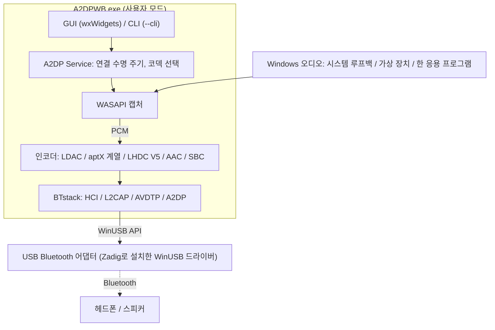
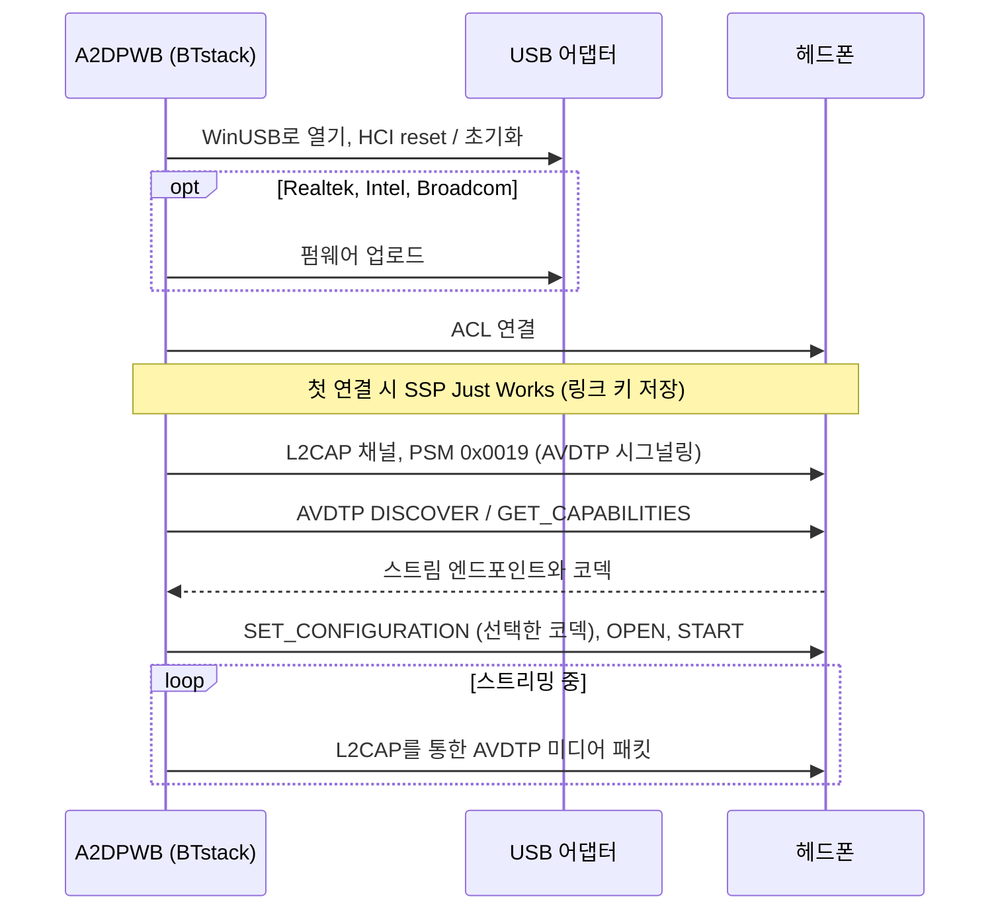
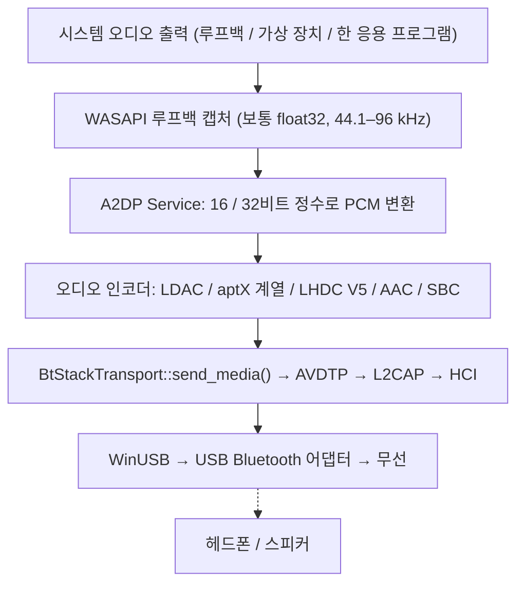
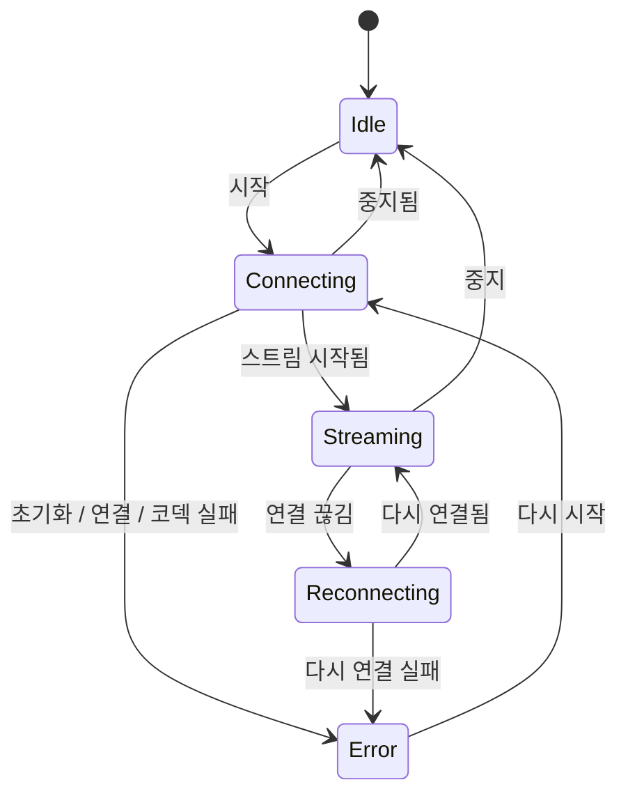

# 아키텍처
{: .no_toc }

## 목차
{: .no_toc .text-delta }

1. TOC
{:toc}

---

## 개요

A2DP Windows Bridge(A2DPWB)는 Windows에서 LDAC, aptX HD, aptX Low Latency, aptX,
AAC, SBC Bluetooth 오디오를 사용할 수 있게 합니다. Windows 자체 Bluetooth 스택은
A2DP에서 SBC, 기본 aptX, (Windows 11만) AAC만 지원합니다. 이 도구는 커널 드라이버 없이
LDAC, aptX HD, aptX Low Latency를 추가합니다.

**BTstack + WinUSB**를 사용하며, 완전히 사용자 모드에서 작동하므로 드라이버 서명이 필요 없습니다.



## 왜 이런 절차가 필요한가

자체 오디오 드라이버를 만들 수 있다면 A2DPWB는 설치만 하면 됩니다. 헤드폰은 내장 Bluetooth를 그대로 쓰면서 일반 Windows 오디오 장치로 나타납니다. 하지만 Windows 10 / 11은 Microsoft의 서명을 받은 커널 모드 드라이버만 로드하며, 그 서명을 받으려면 EV 코드 서명 인증서가 필요합니다. 이 인증서는 연간 약 300–700 USD이고 원칙적으로 등록된 법인에만 발급되므로, 개인 프로젝트가 감당하기 어렵습니다. 그래서 A2DPWB는 Microsoft 서명 WinUSB 드라이버로 USB Bluetooth 어댑터를 통째로 Windows에서 분리하고, Bluetooth 스택을 사용자 모드에서 직접 실행하는 우회 방식을 택했습니다. 전용 어댑터, Zadig, (Realtek 어댑터의 경우) 펌웨어 파일이 필요한 이유입니다.

간편함만 원한다면 서명된 드라이버를 제공해 내장 Bluetooth로 바로 쓸 수 있는 유료 소프트웨어도 있습니다. 솔직히 기능에 비해 매우 저렴하므로, 설정의 간편함이 가장 중요하다면 그쪽을 쓰는 것이 좋습니다.

## 전송 계층: BTstack + WinUSB

WinUSB(Microsoft가 서명한 범용 USB 드라이버)를 통해 USB Bluetooth 어댑터와 직접 통신하여
Windows Bluetooth 스택을 완전히 우회합니다. 소스 공개 Bluetooth 스택(비상업적 라이선스)인
BTstack이 HCI, L2CAP, AVDTP, A2DP를 사용자 모드에서 구현합니다.

**장점**:
- 드라이버 서명 비용 없음
- 테스트 서명 모드 불필요
- 보안 부팅 비활성화 불필요
- 모든 코드가 사용자 모드에서 실행됨 (디버깅이 쉬움)

**단점**:
- 전용 USB Bluetooth 어댑터 필요 (Windows 내장 Bluetooth와
  별도)
- WinUSB가 점유하는 동안 어댑터를 일반 Windows Bluetooth로
  사용할 수 없음
- 장치 주소는 직접 입력하거나, (내장 어댑터를 통해 읽은) Windows 페어링 장치
  목록에서 선택하거나, USB 어댑터로 검색(GAP inquiry)하여 찾음

**작동 방식**:
1. 사용자가 Zadig로 USB Bluetooth 어댑터에 WinUSB 드라이버를 설치
2. BTstack이 WinUSB API로 USB 장치를 엶
3. BTstack이 HCI 명령을 보내 Bluetooth 컨트롤러를 초기화
4. (Realtek, Intel, Broadcom 어댑터) 필요하면 펌웨어를 업로드
5. BTstack이 ACL 연결을 설정하고 L2CAP 채널(PSM 0x0019)을 엶
6. AVDTP 시그널링으로 원격 SEP를 검색하고 코덱을 협상
7. 인코딩된 오디오를 L2CAP를 통해 AVDTP 미디어 패킷으로 전송



## 모듈 구조

```
A2DPWB.exe
├── GUI 계층 (wxWidgets)
│   ├── wx_app              앱 진입점, 이벤트 루프
│   ├── wx_main_frame       메인 창 (장치, 코덱, 상태)
│   ├── wx_profile_dialog   연결 프로필 관리, 장치 검색
│   ├── wx_firmware_dialog  Realtek 펌웨어 다운로드
│   ├── wx_about_dialog     정보 / 라이선스 정보
│   ├── wx_zadig_dialog     Zadig WinUSB 설치 안내
│   ├── wx_link_quality_dialog  연결 품질 창 (전송 내용, 무선)
│   ├── wx_receiver_dialog  피어 수신기 테스트 (보낸 내용 vs 받은 내용, 디버그 모드)
│   ├── wx_debug_console_dialog  디버그 콘솔: 실시간 로그, 연결 흐름
│   ├── wx_radio_text.h     두 창에서 쓰는 RSSI / AFH 텍스트
│   ├── theme_manager       라이트 / 다크 테마 지원
│   └── localization        다국어 (en, ja, zh-CN, zh-TW, ko, de, fr, es — 내장 JSON)
│
├── 코어 계층
│   ├── a2dp_service        A2DP 연결 수명 주기 및 상태 머신
│   ├── btstack_transport   BTstack 통합 (HCI, L2CAP, AVDTP, A2DP)
│   ├── btstack_link_key_db_file  링크 키 저장 (설정 폴더의 파일)
│   ├── btstack_uart_tcp_windows  가상 컨트롤러로의 TCP를 통한 H4 (--hci-tcp, 테스트용)
│   ├── wasapi_capture      WASAPI 루프백 오디오 캡처
│   ├── test_tone           캡처한 오디오 대신 테스트 톤
│   ├── audio_encoder       인코더 인터페이스 (추상 기본 클래스)
│   │   ├── ldac_encoder        LDAC (libldac, ABR 지원)
│   │   ├── aptxhd_encoder      aptX HD (libopenaptx)
│   │   ├── aptxll_encoder      aptX Low Latency (libopenaptx)
│   │   ├── aptx_encoder        기본 aptX (libopenaptx)
│   │   ├── aptx_pcm_pack.h     aptX 인코더 공용 PCM → packed 24-bit 변환 도우미
│   │   ├── aac_encoder         AAC-LC (fdk-aac, LATM 전송)
│   │   └── a2dp_sbc_encoder    SBC (BTstack Bluedroid)
│   │
│   ├── bt_device           Bluetooth 장치 정보 (주소, 이름, 코덱)
│   ├── bt_adapter_enum     USB Bluetooth 어댑터 열거 (WinUSB)
│   ├── audio_device_enum   WASAPI 오디오 장치 열거
│   ├── profile_manager     연결 프로필 저장 (JSON)
│   ├── media_payload_limit 최대 미디어 패킷 크기 (범위, 기본값)
│   ├── afh                 Wi-Fi 검색 결과에서 AFH 호스트 채널 분류
│   ├── link_stats          연결 품질 창용 카운터
│   └── remote_sink_client  네트워크를 통한 tools/linux_sink 통계
│
├── 지원
│   ├── app_settings        애플리케이션 설정 저장 (JSON)
│   ├── config_path         설정 파일 경로 결정
│   ├── system_integration  시스템 트레이, 자동 시작
│   ├── debug_log           디버그 로그 매크로
│   ├── debug_log_model     디버그 콘솔용 로그 줄과 연결 흐름
│   ├── hci_capture         필요할 때 하는 HCI 캡처 (.pklg)
│   ├── update_checker      업데이트 확인 (GitHub Releases)
│   ├── zadig_helper        Zadig 다운로드 / 실행
│   ├── embedded_langs      빌드 시 내장되는 언어 파일
│   └── capture_mode        오디오 캡처 모드 정의
│
└── CLI 모드
    └── main.cpp            CLI 인수 구문 분석, 헤드리스 스트리밍
```

## 데이터 흐름



## 주요 모듈

### A2DP Service (`a2dp_service.cpp`)

연결 수명 주기를 총괄하는 관리자입니다. 다음을 조정합니다.
- 코덱 협상 (자동 선택 또는 사용자 지정)
- 지원하는 모든 코덱의 스트림 엔드포인트 등록
- aptX 계열 샘플링 속도 선택 (원격 장치가 알리는 속도 중 44.1 / 48 kHz,
  캡처는 WASAPI가 리샘플링)
- 인코더용 PCM 변환 (float32 → 16 / 32비트 정수)
- 연결 상태 머신 (idle → connecting → streaming → reconnecting, error)
- 예기치 않은 연결 끊김 시 자동 다시 연결 로직
- 코덱별 프레이밍을 적용한 미디어 패킷 전송

연결 상태 머신 (`A2dpService::State`):



### BTstack Transport (`btstack_transport.cpp`)

애플리케이션의 동기식 모델과 BTstack의 이벤트 기반 API를
연결하는 브리지입니다.

**역할**:
- WinUSB HCI 전송으로 BTstack 초기화
- 전용 스레드에서 BTstack 이벤트 루프 실행
- 스트림 엔드포인트 등록: 벤더 코덱(LDAC, aptX HD, aptX, aptX LL)
  및 SBC, AAC
- SDP 레코드 등록 (A2DP Source, AVRCP Controller, AVRCP Target)
- 원격 기능 구문 분석 (두 벤더 ID의 aptX LL과
  aptX Adaptive 포함, aptX Adaptive는 감지하여 로그에만 기록)
- 비동기→동기 래퍼를 통한 A2DP 연결 수명 주기 처리
- SSP 페어링 관리 (Just Works, General Bonding, 링크 키 저장)
- 연결 시간 초과 후 반쯤 열린 연결을 해제하여 재시도가 가능하도록 함
- 실패한 연결을 재시도하고(최대 3회) 원인을 구분(응답 없음, 데이터 없는
  링크, 원격 장치가 링크 종료, 인증), 장치가 더 이상 모르는 링크 키는
  삭제하고 다시 페어링
- 장치 검색을 위한 GAP inquiry
- AFH 호스트 채널 분류 및 연결 품질 창용 RSSI / AFH 읽기
- WASAPI 콜백을 위한 스레드 안전 미디어 전송 제공
- Realtek, Intel, Broadcom 칩셋용 펌웨어 로딩

**사용하는 주요 BTstack API**:
- `a2dp_source_create_stream_endpoint()` — 코덱 엔드포인트 등록
- `a2dp_source_establish_stream()` — A2DP 싱크에 연결
- `a2dp_source_set_config_other()` — 벤더별 코덱 구성
- `a2dp_source_stream_send_media_payload_rtp()` — 인코딩된 오디오를
  RTP 헤더와 함께 전송 (LDAC, aptX HD, AAC, SBC)
- `a2dp_source_stream_send_media_packet()` — RTP 헤더 없이 원시 미디어
  패킷 전송 (aptX, aptX LL)

### WASAPI Capture (`wasapi_capture.cpp`)

Windows Audio Session API를 사용하여 시스템 오디오 출력을 실시간으로 캡처합니다.
- `IAudioClient`를 `AUDCLNT_STREAMFLAGS_LOOPBACK` 모드로 사용
- 장치의 공유 모드 믹스 형식을 전달 (보통 float32, A2DP Service가
  인코더용으로 변환)
- 오디오 장치 선택 가능

### 오디오 인코더

| 인코더 | 라이브러리 | 비트레이트 | 특징 |
|---------|---------|---------|----------|
| LDAC | libldac (AOSP) | 330/660/990 kbps | HQ/SQ/MQ 모드, ABR |
| aptX HD | libopenaptx | 576 kbps | 24비트 입력, 고정 비트레이트, RTP 헤더 |
| aptX LL | libopenaptx | 352 kbps | 약 32 ms 지연, RTP 헤더 없음, 패킷 ≤ 약 7.5 ms |
| aptX | libopenaptx | 352/384 kbps (44.1/48 kHz) | 16비트 스테레오, RTP 헤더 없음 |
| AAC | fdk-aac | 최대 256 kbps | AAC-LC, LATM 전송 |
| SBC | BTstack Bluedroid | 최대 약 345 kbps | A2DP 필수 기본 코덱 |
| LHDC V5 | lhdcv5-enc (AOSP 인코더의 C 포팅) | 400/500/900/1000 kbps, ABR 160–400 kbps | 16/24비트, 5 ms 프레임, 2바이트 미디어 페이로드 헤더, RTP 헤더 |

모든 인코더는 `encode()`와 `get_frame_size()` 메서드를 가진
`AudioEncoder` 인터페이스를 구현합니다.

libopenaptx는 스테레오 샘플 4개 단위의 packed 24-bit little-endian
PCM을 입력으로 받습니다. `aptx_pcm_pack.h`는 캡처한 16비트 또는 32비트(MSB 정렬)
샘플을 aptX, aptX HD, aptX LL 인코더용으로 이 형식으로 변환하며, 모노 입력은
양쪽 채널에 복제합니다.

## 벤더 코덱 정보 요소

비표준 코덱은 AVDTP에서 Vendor Specific으로 등록됩니다.

| 코덱 | Vendor ID | Codec ID |
|-------|-----------|----------|
| LDAC | Sony (0x0000012D) | 0x00AA |
| aptX | APT (0x0000004F) | 0x0001 |
| aptX HD | Qualcomm (0x000000D7) | 0x0024 |
| aptX Low Latency | CSR (0x0000000A) 또는 Qualcomm (0x000000D7) | 0x0002 |
| aptX Adaptive | Qualcomm (0x000000D7) | 0x00AD (감지만 하며 선택하지 않음) |
| LHDC V5 | Savitech (0x0000053A) | 0x4C35 |

AAC와 SBC는 A2DP 사양에 정의된 표준 A2DP 코덱 ID를 사용합니다.

코덱 정보 요소 크기 (6바이트 vendor/codec ID 포함):

- **aptX**: 7바이트 (바이트 6 = 샘플링 속도 / 채널 모드)
- **aptX HD**: 11바이트 (바이트 6은 aptX와 동일, 예약 바이트 4개 추가), 스테레오
  필수
- **aptX LL**: 8바이트, 싱크가 확장("new caps") 플래그를 설정하면
  17바이트. A2DPWB는 aptX LL 엔드포인트 하나를 등록하고, 싱크가 사용한
  vendor ID로 스트림을 구성
- **LHDC V5**: 11바이트 (Android `a2dp_vendor_lhdcv5_constants.h`): 바이트 6은
  샘플링 속도(0x20 44.1k, 0x10 48k, 0x04 96k, 0x01 192k), 바이트 7은 비트 심도
  (0x04 16-bit, 0x02 24-bit)와 싱크의 최소/최대 비트레이트 제한, 바이트 8은
  코덱 하위 버전(0x01 = V5 ver.1)과 0x10 = 5 ms 프레임, 바이트 9-10은
  선택 기능(low latency, lossless, JAS, AR, META)이며 A2DPWB는 이 중 어느 것도
  제공하지 않음. 스테레오만 지원. 싱크의 비트레이트 제한은 Android와 마찬가지로
  구성에 그대로 반영되고 인코더에 적용됨. 미디어 패킷에는 2바이트 페이로드 헤더가
  포함됨: frame count << 2 (지연 비트 0)와 시퀀스 번호

**RTP 사용 여부**: LDAC, aptX HD, AAC, SBC, LHDC V5 미디어 패킷에는
12바이트 RTP 헤더가 붙습니다. aptX와 aptX LL은 (Android 및
PipeWire와 마찬가지로) RTP 헤더 **없이** 전송되므로, L2CAP MTU 전체를 aptX 프레임에 사용할 수 있습니다.

**aptX Adaptive**는 오픈 소스 인코더가 없으므로(libopenaptx는 이를
구현하지 않음) A2DPWB는 이를 등록하거나 선택하지 않습니다. 싱크가 이를 제공하면
A2DPWB는 로그에만 기록하며, 싱크가 기본 aptX를 별도로 제공하면 그것을 사용합니다.

## 빌드 시스템

- MSVC(Visual Studio 2022 이상)와 **CMake** 사용
- 서드파티 라이브러리는 소스에서 정적 라이브러리로 빌드
- wxWidgets는 configure 시 CMake FetchContent로 가져옴 (v3.2.6)
- 언어 파일(JSON)은 configure 시 실행 파일에 내장
- 애플리케이션 매니페스트와 아이콘은 Windows 리소스 스크립트로 컴파일

## 중요 고려 사항

- **어댑터 호환성**: Realtek(가장 많이 테스트됨)과 CSR USB 어댑터. Intel과
  Broadcom은 실험적. Realtek 어댑터는 시작 시 펌웨어 업로드가 필요하며,
  부트로더 모드의 Intel 어댑터도 마찬가지
- **페어링**: General Bonding과 함께 SSP Just Works 사용. 링크 키는
  로컬 파일에 저장
- **두 번째 어댑터 권장**: 내장 Bluetooth는 Windows용으로 유지하고,
  A2DPWB에는 전용 USB 어댑터 사용
- 일부 Bluetooth 어댑터는 펌웨어 때문에 달성 가능한 비트레이트가 제한됨
- USB Bluetooth 5.0 이상 어댑터는 일반적으로 LDAC에서 잘 작동함
- 자동 코덱 선택 우선순위: LDAC > aptX HD > aptX LL > aptX > LHDC V5 > AAC > SBC
