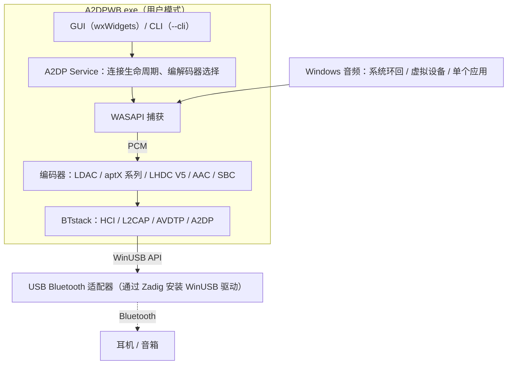
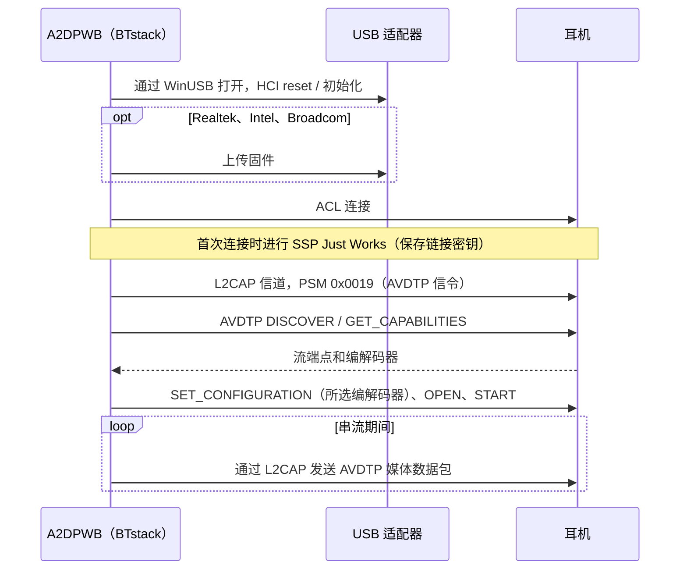
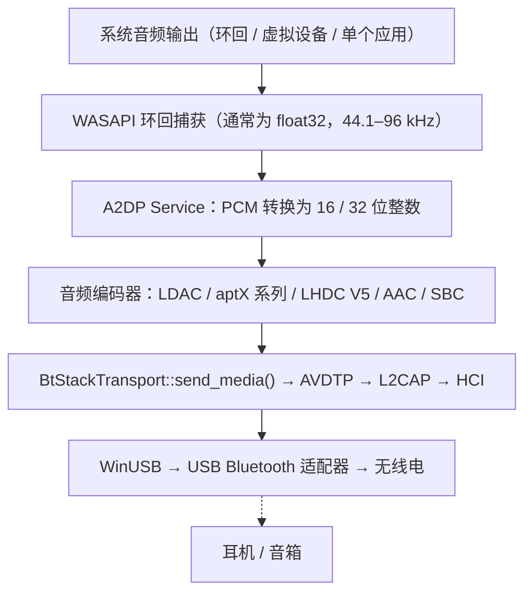
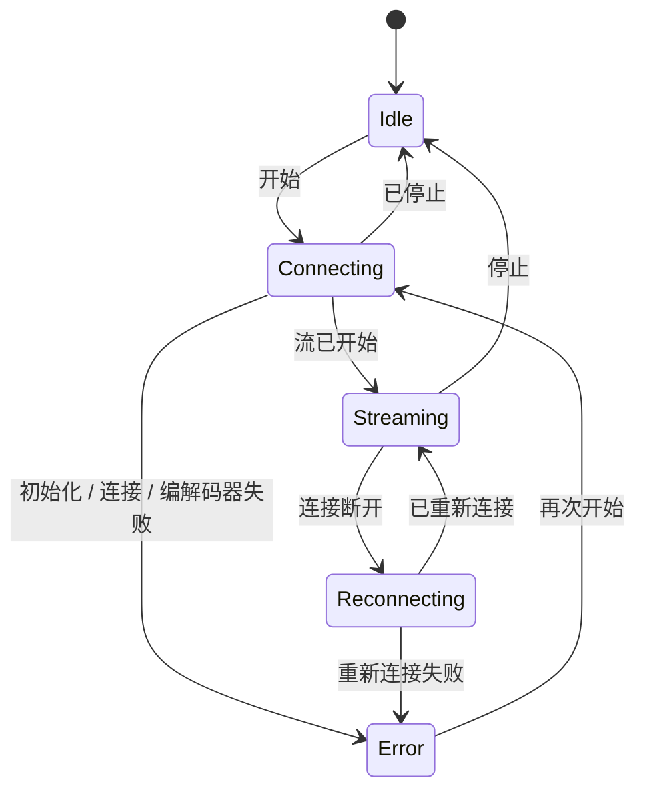

# 架构
{: .no_toc }

## 目录
{: .no_toc .text-delta }

1. TOC
{:toc}

---

## 概述

A2DP Windows Bridge (A2DPWB) 让 Windows 能够使用 LDAC、aptX HD、aptX Low Latency、aptX、AAC 和 SBC 的 Bluetooth 音频。Windows 自带的 Bluetooth 堆栈在 A2DP 上只支持 SBC、经典 aptX 以及（仅限 Windows 11）AAC——本工具无需内核驱动即可增加 LDAC、aptX HD 和 aptX Low Latency。

使用 **BTstack + WinUSB**——完全在用户模式下运行，无需驱动签名。



## 传输层：BTstack + WinUSB

通过 WinUSB（Microsoft 签名的通用 USB 驱动）直接与 USB Bluetooth 适配器通信，完全绕过 Windows 的 Bluetooth 堆栈。BTstack 是一个源代码公开的 Bluetooth 堆栈（非商业许可），在用户模式下实现 HCI、L2CAP、AVDTP 和 A2DP。

**优点**：
- 无需驱动签名费用
- 无需测试签名模式
- 无需禁用安全启动（Secure Boot）
- 所有代码都在用户模式下运行（更易于调试）

**取舍**：
- 需要一个专用的 USB Bluetooth 适配器（独立于 Windows 的内置 Bluetooth）
- 被 WinUSB 占用期间，该适配器无法用于 Windows 的普通 Bluetooth
- 设备地址需手动输入、从 Windows 已配对设备列表中选择（通过内置适配器读取），或通过 USB 适配器扫描（GAP inquiry）查找

**工作原理**：
1. 用户通过 Zadig 为 USB Bluetooth 适配器安装 WinUSB 驱动
2. BTstack 通过 WinUSB API 打开 USB 设备
3. BTstack 发送 HCI 命令初始化 Bluetooth 控制器
4. （Realtek、Intel 和 Broadcom 适配器）根据需要上传固件
5. BTstack 建立 ACL 连接并打开 L2CAP 信道（PSM 0x0019）
6. AVDTP 信令发现远端 SEP 并协商编解码器
7. 编码后的音频作为 AVDTP 媒体数据包通过 L2CAP 发送



## 模块结构

```
A2DPWB.exe
├── GUI Layer (wxWidgets)
│   ├── wx_app              App entry point, event loop
│   ├── wx_main_frame       Main window (device, codec, status)
│   ├── wx_profile_dialog   Connection profile management, device scan
│   ├── wx_firmware_dialog  Realtek firmware download
│   ├── wx_about_dialog     About / license info
│   ├── wx_zadig_dialog     Zadig WinUSB installation guide
│   ├── wx_link_quality_dialog  Link quality window (what is sent, radio)
│   ├── wx_receiver_dialog  Peer receiver test (sent vs. received, debug mode)
│   ├── wx_debug_console_dialog  Debug console: live log, connection flow
│   ├── wx_radio_text.h     RSSI / AFH as text for both windows
│   ├── theme_manager       Light / dark theme support
│   └── localization        i18n (en, ja, zh-CN, zh-TW, ko, de, fr, es — embedded JSON)
│
├── Core Layer
│   ├── a2dp_service        A2DP connection lifecycle & state machine
│   ├── btstack_transport   BTstack integration (HCI, L2CAP, AVDTP, A2DP)
│   ├── btstack_link_key_db_file  Link key storage (file in the config folder)
│   ├── btstack_uart_tcp_windows  H4 over TCP to a virtual controller (--hci-tcp, testing)
│   ├── wasapi_capture      WASAPI loopback audio capture
│   ├── test_tone           Test tone instead of captured audio
│   ├── audio_encoder       Encoder interface (abstract base)
│   │   ├── ldac_encoder        LDAC (libldac, ABR support)
│   │   ├── aptxhd_encoder      aptX HD (libopenaptx)
│   │   ├── aptxll_encoder      aptX Low Latency (libopenaptx)
│   │   ├── aptx_encoder        aptX classic (libopenaptx)
│   │   ├── aptx_pcm_pack.h     Shared PCM → packed 24-bit helper for aptX encoders
│   │   ├── aac_encoder         AAC-LC (fdk-aac, LATM transport)
│   │   └── a2dp_sbc_encoder    SBC (BTstack Bluedroid)
│   │
│   ├── bt_device           Bluetooth device info (address, name, codecs)
│   ├── bt_adapter_enum     USB Bluetooth adapter enumeration (WinUSB)
│   ├── audio_device_enum   WASAPI audio device enumeration
│   ├── profile_manager     Connection profile persistence (JSON)
│   ├── media_payload_limit Max media packet size (range, default)
│   ├── afh                 AFH host channel classification from the Wi-Fi scan
│   ├── link_stats          Counters for the link quality window
│   └── remote_sink_client  Statistics from tools/linux_sink over the network
│
├── Support
│   ├── app_settings        Persistent application settings (JSON)
│   ├── config_path         Config file path resolution
│   ├── system_integration  System tray, autostart
│   ├── debug_log           Debug logging macros
│   ├── debug_log_model     Log lines and connection flow for the debug console
│   ├── hci_capture         On-demand HCI capture (.pklg)
│   ├── update_checker      Update check (GitHub Releases)
│   ├── zadig_helper        Zadig download / launch
│   ├── embedded_langs      Language files embedded at build time
│   └── capture_mode        Audio capture mode definitions
│
└── CLI Mode
    └── main.cpp            CLI argument parsing, headless streaming
```

## 数据流



## 主要模块

### A2DP Service（`a2dp_service.cpp`）

核心的连接生命周期管理器。负责协调：
- 编解码器协商（自动选择或由用户指定）
- 为所有支持的编解码器注册流端点
- aptX 系列的采样率选择（从远端通告的采样率中选择 44.1 / 48 kHz；由 WASAPI 对捕获的音频重采样）
- 为编码器进行 PCM 转换（float32 → 16 / 32 位整数）
- 连接状态机（idle → connecting → streaming → reconnecting，error）
- 意外断开时的自动重新连接逻辑
- 按编解码器特定的分帧方式发送媒体数据包

连接状态机（`A2dpService::State`）：



### BTstack Transport（`btstack_transport.cpp`）

在应用程序的同步模型与 BTstack 的事件驱动 API 之间起桥接作用。

**职责**：
- 使用 WinUSB HCI 传输初始化 BTstack
- 在专用线程中运行 BTstack 事件循环
- 注册流端点：厂商编解码器（LDAC、aptX HD、aptX、aptX LL）以及 SBC 和 AAC
- 注册 SDP 记录（A2DP Source、AVRCP Controller、AVRCP Target）
- 解析远端能力，包括两种厂商 ID 下的 aptX LL 以及 aptX Adaptive（仅检测并记录到日志）
- 通过异步转同步的封装处理 A2DP 连接生命周期
- 管理 SSP 配对（Just Works、General Bonding；链接密钥持久保存）
- 连接超时后断开半开的连接，以便重试能够正常进行
- 重试失败的连接（最多 3 次），并区分失败原因（无应答、链路无数据、远端主动断开、身份验证）；丢弃设备已不再识别的链接密钥并重新配对
- 用于设备扫描的 GAP inquiry
- AFH 主机信道分类，以及为链路质量窗口读取 RSSI / AFH
- 为 WASAPI 回调提供线程安全的媒体发送
- 为 Realtek、Intel 和 Broadcom 芯片组加载固件

**使用的主要 BTstack API**：
- `a2dp_source_create_stream_endpoint()`——注册编解码器端点
- `a2dp_source_establish_stream()`——连接到 A2DP 接收端
- `a2dp_source_set_config_other()`——配置厂商特定的编解码器
- `a2dp_source_stream_send_media_payload_rtp()`——发送带 RTP 标头的编码音频（LDAC、aptX HD、AAC、SBC）
- `a2dp_source_stream_send_media_packet()`——发送不带 RTP 标头的原始媒体数据包（aptX、aptX LL）

### WASAPI 捕获（`wasapi_capture.cpp`）

使用 Windows 音频会话 API（WASAPI）实时捕获系统音频输出。
- 以 `AUDCLNT_STREAMFLAGS_LOOPBACK` 模式使用 `IAudioClient`
- 提供设备在共享模式下的混音格式（通常为 float32；由 A2DP Service 为编码器转换）
- 可配置音频设备选择

### 音频编码器

| 编码器 | 库 | 比特率 | 特性 |
|---------|---------|---------|----------|
| LDAC | libldac (AOSP) | 330/660/990 kbps | HQ/SQ/MQ 模式，ABR |
| aptX HD | libopenaptx | 576 kbps | 24-bit 输入，固定码率，RTP 标头 |
| aptX LL | libopenaptx | 352 kbps | 约 32 ms 延迟，无 RTP 标头，数据包 ≤ 约 7.5 ms |
| aptX | libopenaptx | 352/384 kbps（44.1/48 kHz） | 16-bit 立体声，无 RTP 标头 |
| AAC | fdk-aac | 最高 256 kbps | AAC-LC，LATM 传输 |
| SBC | BTstack Bluedroid | 最高约 345 kbps | A2DP 必备的基础编解码器 |
| LHDC V5 | lhdcv5-enc（AOSP 编码器的 C 语言移植版） | 400/500/900/1000 kbps，ABR 160–400 kbps | 实验性；16/24-bit，5 ms 帧，2 字节媒体负载标头，RTP 标头 |

所有编码器都实现了 `AudioEncoder` 接口，提供 `encode()` 和 `get_frame_size()` 方法。

libopenaptx 要求输入为每组 4 个立体声采样、打包为 24 位小端序的 PCM。`aptx_pcm_pack.h` 为 aptX、aptX HD 和 aptX LL 编码器将捕获的 16 位或 32 位（MSB 对齐）采样转换为该格式；单声道输入会复制到两个声道。

## 厂商编解码器信息元素

非标准编解码器在 AVDTP 中注册为 Vendor Specific：

| 编解码器 | Vendor ID | Codec ID |
|-------|-----------|----------|
| LDAC | Sony (0x0000012D) | 0x00AA |
| aptX | APT (0x0000004F) | 0x0001 |
| aptX HD | Qualcomm (0x000000D7) | 0x0024 |
| aptX Low Latency | CSR (0x0000000A) 或 Qualcomm (0x000000D7) | 0x0002 |
| aptX Adaptive | Qualcomm (0x000000D7) | 0x00AD（仅检测，永不选择） |
| LHDC V5 | Savitech (0x0000053A) | 0x4C35 |

AAC 和 SBC 使用 A2DP 规范中定义的标准 A2DP 编解码器 ID。

编解码器信息元素的大小（包括 6 字节的 vendor/codec ID）：

- **aptX**：7 字节（第 6 字节 = 采样率 / 声道模式）
- **aptX HD**：11 字节（第 6 字节同 aptX，另加 4 个保留字节）；必须为立体声
- **aptX LL**：8 字节；当接收端设置了扩展（“new caps”）标志时为 17 字节。A2DPWB 只注册一个 aptX LL 端点，并以接收端所用的 vendor ID 配置流
- **LHDC V5**：11 字节（Android `a2dp_vendor_lhdcv5_constants.h`）：第 6 字节为采样率（0x20 44.1k、0x10 48k、0x04 96k、0x01 192k），第 7 字节为位深度（0x04 16-bit、0x02 24-bit）以及接收端的最小/最大比特率限制，第 8 字节为编解码器子版本（0x01 = V5 ver.1）和 0x10 = 5 ms 帧，第 9-10 字节为可选功能（低延迟、无损、JAS、AR、META），A2DPWB 均不提供。仅支持立体声。与 Android 一样，接收端的比特率限制会在配置中回传并应用到编码器。媒体数据包带有 2 字节的负载标头：帧数 << 2（延迟位为 0）以及序列号

**有无 RTP**：LDAC、aptX HD、AAC、SBC 和 LHDC V5 的媒体数据包带有 12 字节的 RTP 标头。aptX 和 aptX LL **不带** RTP 标头发送（与 Android 和 PipeWire 相同），因此整个 L2CAP MTU 都可用于 aptX 帧。

**aptX Adaptive** 没有开源编码器（libopenaptx 未实现它），因此 A2DPWB 从不注册或选择它。当接收端列出它时，A2DPWB 只会记录到日志；如果接收端另外列出了经典 aptX，则使用经典 aptX。

## 构建系统

- **CMake** 配合 MSVC（Visual Studio 2022 或更高版本）
- 第三方库从源代码构建为静态库
- wxWidgets 在配置阶段通过 CMake FetchContent 获取（v3.2.6）
- 语言文件（JSON）在配置阶段嵌入可执行文件
- 应用程序清单和图标通过 Windows 资源脚本编译

## 重要注意事项

- **适配器兼容性**：Realtek（测试最充分）和 CSR USB 适配器；Intel 和 Broadcom 为实验性支持。Realtek 适配器需要在启动时上传固件，处于 bootloader 模式的 Intel 适配器也是如此
- **配对**：使用 SSP Just Works 和 General Bonding。链接密钥持久保存到本地文件
- **建议使用第二个适配器**：内置 Bluetooth 留给 Windows 使用，专用 USB 适配器用于 A2DPWB
- 某些 Bluetooth 适配器的固件会限制可达到的比特率
- USB Bluetooth 5.0+ 适配器通常能很好地支持 LDAC
- 自动选择编解码器的优先级：LDAC > aptX HD > aptX LL > aptX > LHDC V5（实验性）> AAC > SBC
