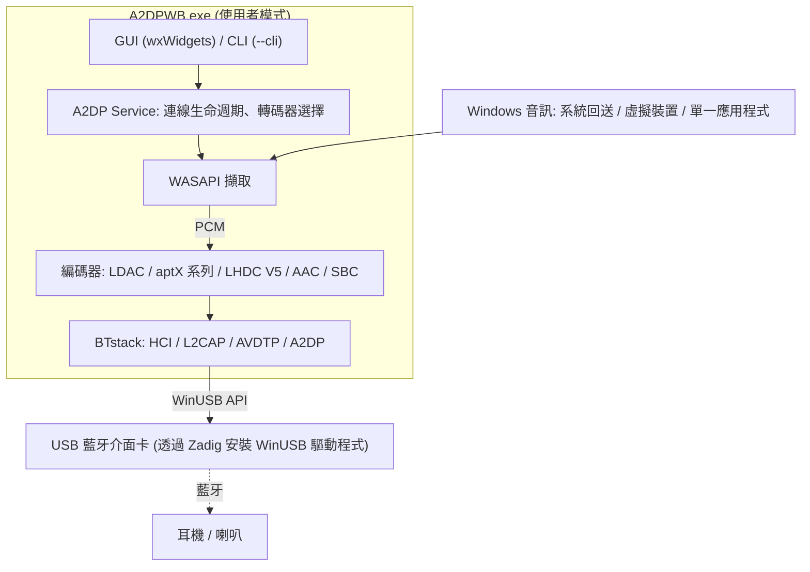
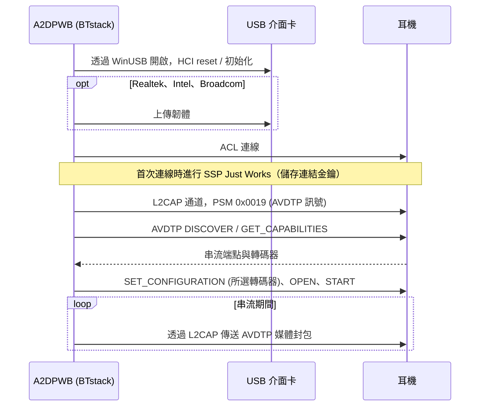
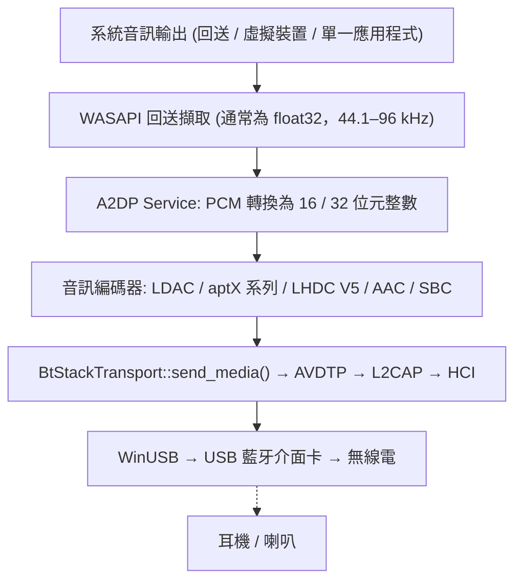
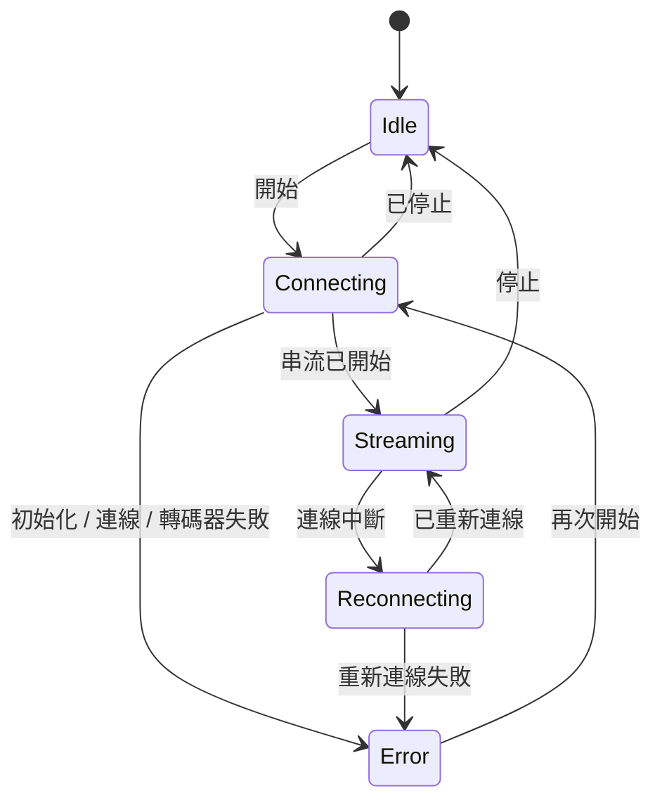

# 架構
{: .no_toc }

## 目錄
{: .no_toc .text-delta }

1. TOC
{:toc}

---

## 概觀

A2DP Windows Bridge (A2DPWB) 讓 Windows 能使用 LDAC、aptX HD、aptX Low Latency、aptX、
AAC 與 SBC 藍牙音訊。Windows 本身的藍牙堆疊在 A2DP 上只支援 SBC、傳統 aptX
與（僅限 Windows 11）AAC — 本工具不需核心驅動程式即可加入 LDAC、aptX HD 與 aptX
Low Latency。

使用 **BTstack + WinUSB** — 完全在使用者模式下運作，不需要驅動程式簽章。



## 傳輸：BTstack + WinUSB

透過 WinUSB（Microsoft 簽署的通用 USB 驅動程式）直接與 USB 藍牙介面卡通訊，
完全繞過 Windows 藍牙堆疊。BTstack 是一個公開原始碼的藍牙堆疊（非商業授權），
在使用者模式下實作 HCI、L2CAP、AVDTP 與 A2DP。

**優點**：
- 不需要驅動程式簽章費用
- 不需要測試簽章模式
- 不需要停用安全開機
- 所有程式碼都在使用者模式下執行（較容易偵錯）

**取捨**：
- 需要專用的 USB 藍牙介面卡（與 Windows 內建藍牙分開）
- 由 WinUSB 佔用期間，該介面卡無法用於一般的 Windows 藍牙
- 裝置位址需手動輸入、從 Windows 已配對裝置清單中選取（透過內建介面卡讀取），
  或以 USB 介面卡掃描（GAP inquiry）找到

**運作方式**：
1. 使用者透過 Zadig 在 USB 藍牙介面卡上安裝 WinUSB 驅動程式
2. BTstack 透過 WinUSB API 開啟 USB 裝置
3. BTstack 傳送 HCI 命令以初始化藍牙控制器
4. （Realtek、Intel 與 Broadcom 介面卡）視需要上傳韌體
5. BTstack 建立 ACL 連線並開啟 L2CAP 通道（PSM 0x0019）
6. AVDTP 訊號探索遠端 SEP 並協商轉碼器
7. 編碼後的音訊以 AVDTP 媒體封包透過 L2CAP 傳送



## 模組結構

```
A2DPWB.exe
├── GUI 層 (wxWidgets)
│   ├── wx_app              應用程式進入點、事件迴圈
│   ├── wx_main_frame       主視窗（裝置、轉碼器、狀態）
│   ├── wx_profile_dialog   連線設定檔管理、裝置掃描
│   ├── wx_firmware_dialog  Realtek 韌體下載
│   ├── wx_about_dialog     關於 / 授權資訊
│   ├── wx_zadig_dialog     Zadig WinUSB 安裝引導
│   ├── wx_link_quality_dialog  連線品質視窗（傳送內容、無線電）
│   ├── wx_receiver_dialog  對端接收器測試（傳送與接收對照，偵錯模式）
│   ├── wx_debug_console_dialog  偵錯主控台：即時記錄、連線流程
│   ├── wx_radio_text.h     兩個視窗共用的 RSSI / AFH 文字
│   ├── theme_manager       淺色 / 深色佈景主題支援
│   └── localization        多語系（en、ja、zh-CN、zh-TW、ko、de、fr、es — 內嵌 JSON）
│
├── 核心層
│   ├── a2dp_service        A2DP 連線生命週期與狀態機
│   ├── btstack_transport   BTstack 整合（HCI、L2CAP、AVDTP、A2DP）
│   ├── btstack_link_key_db_file  連結金鑰儲存（設定資料夾中的檔案）
│   ├── btstack_uart_tcp_windows  以 H4 over TCP 連線到虛擬控制器（--hci-tcp，測試用）
│   ├── wasapi_capture      WASAPI 回送音訊擷取
│   ├── test_tone           以測試音取代擷取的音訊
│   ├── audio_encoder       編碼器介面（抽象基底類別）
│   │   ├── ldac_encoder        LDAC（libldac，支援 ABR）
│   │   ├── aptxhd_encoder      aptX HD（libopenaptx）
│   │   ├── aptxll_encoder      aptX Low Latency（libopenaptx）
│   │   ├── aptx_encoder        傳統 aptX（libopenaptx）
│   │   ├── aptx_pcm_pack.h     aptX 編碼器共用的 PCM → packed 24-bit 輔助程式
│   │   ├── aac_encoder         AAC-LC（fdk-aac，LATM 傳輸）
│   │   └── a2dp_sbc_encoder    SBC（BTstack Bluedroid）
│   │
│   ├── bt_device           藍牙裝置資訊（位址、名稱、轉碼器）
│   ├── bt_adapter_enum     USB 藍牙介面卡列舉（WinUSB）
│   ├── audio_device_enum   WASAPI 音訊裝置列舉
│   ├── profile_manager     連線設定檔的保存（JSON）
│   ├── media_payload_limit 媒體封包大小上限（範圍、預設值）
│   ├── afh                 依 Wi-Fi 掃描結果進行 AFH 主機通道分類
│   ├── link_stats          連線品質視窗用的計數器
│   └── remote_sink_client  透過網路取得 tools/linux_sink 的統計資料
│
├── 支援
│   ├── app_settings        保存的應用程式設定（JSON）
│   ├── config_path         設定檔路徑解析
│   ├── system_integration  系統匣、自動啟動
│   ├── debug_log           偵錯記錄巨集
│   ├── debug_log_model     偵錯主控台用的記錄行與連線流程
│   ├── hci_capture         隨需 HCI 擷取（.pklg）
│   ├── update_checker      更新檢查（GitHub Releases）
│   ├── zadig_helper        Zadig 下載 / 啟動
│   ├── embedded_langs      建置時內嵌的語言檔
│   └── capture_mode        音訊擷取模式定義
│
└── CLI 模式
    └── main.cpp            CLI 引數解析、無介面串流
```

## 資料流



## 主要模組

### A2DP Service (`a2dp_service.cpp`)

連線生命週期的核心管理者。負責協調：
- 轉碼器協商（自動選擇或使用者指定）
- 為所有支援的轉碼器註冊串流端點
- aptX 系列的取樣率選擇（從遠端公布的取樣率中選擇 44.1 / 48 kHz；
  由 WASAPI 對擷取的音訊重新取樣）
- 為編碼器進行 PCM 轉換（float32 → 16 / 32 位元整數）
- 連線狀態機（閒置 → 連線中 → 串流中 → 重新連線中、錯誤）
- 意外斷線時的自動重新連線邏輯
- 依轉碼器分幀方式傳送媒體封包

連線狀態機（`A2dpService::State`）：



### BTstack Transport (`btstack_transport.cpp`)

應用程式的同步模型與 BTstack 事件驅動 API 之間的橋樑。

**職責**：
- 以 WinUSB HCI 傳輸初始化 BTstack
- 在專用執行緒中執行 BTstack 事件迴圈
- 註冊串流端點：廠商轉碼器（LDAC、aptX HD、aptX、aptX LL）
  以及 SBC 與 AAC
- 註冊 SDP 記錄（A2DP Source、AVRCP Controller、AVRCP Target）
- 解析遠端功能，包括兩種 Vendor ID 下的 aptX LL，以及
  aptX Adaptive（僅偵測並記錄）
- 透過非同步轉同步的包裝函式處理 A2DP 連線生命週期
- 管理 SSP 配對（Just Works、General Bonding；保存連結金鑰）
- 連線逾時後拆除半開的連線，讓重試能正常運作
- 重試失敗的連線（最多 3 次）並區分原因（沒有回應、連結無資料、
  遠端結束連結、驗證）；捨棄裝置已不認得的連結金鑰並重新配對
- 用於裝置掃描的 GAP inquiry
- AFH 主機通道分類，以及供連線品質視窗使用的 RSSI / AFH 讀數
- 為 WASAPI 回呼提供執行緒安全的媒體傳送
- Realtek、Intel 與 Broadcom 晶片組的韌體載入

**使用的主要 BTstack API**：
- `a2dp_source_create_stream_endpoint()` — 註冊轉碼器端點
- `a2dp_source_establish_stream()` — 連線到 A2DP 接收端
- `a2dp_source_set_config_other()` — 設定廠商專屬轉碼器
- `a2dp_source_stream_send_media_payload_rtp()` — 傳送附 RTP 標頭的
  編碼音訊（LDAC、aptX HD、AAC、SBC）
- `a2dp_source_stream_send_media_packet()` — 傳送不含 RTP 標頭的
  原始媒體封包（aptX、aptX LL）

### WASAPI 擷取 (`wasapi_capture.cpp`)

使用 Windows Audio Session API 即時擷取系統音訊輸出。
- 以 `AUDCLNT_STREAMFLAGS_LOOPBACK` 模式使用 `IAudioClient`
- 提供裝置共用模式的混音格式（通常為 float32；由 A2DP Service
  為編碼器轉換）
- 可選擇音訊裝置

### 音訊編碼器

| 編碼器 | 程式庫 | 位元率 | 特色 |
|---------|---------|---------|----------|
| LDAC | libldac (AOSP) | 330/660/990 kbps | HQ/SQ/MQ 模式、ABR |
| aptX HD | libopenaptx | 576 kbps | 24 位元輸入、固定位元率、RTP 標頭 |
| aptX LL | libopenaptx | 352 kbps | 約 32 ms 延遲、無 RTP 標頭、封包 ≤ 約 7.5 ms |
| aptX | libopenaptx | 352/384 kbps (44.1/48 kHz) | 16 位元立體聲、無 RTP 標頭 |
| AAC | fdk-aac | 最高 256 kbps | AAC-LC、LATM 傳輸 |
| SBC | BTstack Bluedroid | 最高約 345 kbps | A2DP 必備的基本轉碼器 |
| LHDC V5 | lhdcv5-enc（AOSP 編碼器的 C 語言移植版） | 400/500/900/1000 kbps，ABR 160–400 kbps | 實驗性；16/24 位元、5 ms 訊框、2 位元組媒體酬載標頭、RTP 標頭 |

所有編碼器都實作 `AudioEncoder` 介面，提供 `encode()` 與
`get_frame_size()` 方法。

libopenaptx 預期的輸入是以 4 個立體聲取樣為一組的 packed 24-bit little-endian
PCM。`aptx_pcm_pack.h` 會將擷取的 16 位元或 32 位元（MSB 對齊）取樣轉換為
該格式，供 aptX、aptX HD 與 aptX LL 編碼器使用；單聲道輸入會複製到兩個聲道。

## 廠商轉碼器資訊元素

非標準轉碼器在 AVDTP 中以 Vendor Specific 註冊：

| 轉碼器 | Vendor ID | Codec ID |
|-------|-----------|----------|
| LDAC | Sony (0x0000012D) | 0x00AA |
| aptX | APT (0x0000004F) | 0x0001 |
| aptX HD | Qualcomm (0x000000D7) | 0x0024 |
| aptX Low Latency | CSR (0x0000000A) 或 Qualcomm (0x000000D7) | 0x0002 |
| aptX Adaptive | Qualcomm (0x000000D7) | 0x00AD（僅偵測，永不選用） |
| LHDC V5 | Savitech (0x0000053A) | 0x4C35 |

AAC 與 SBC 使用 A2DP 規格中定義的標準 A2DP Codec ID。

轉碼器資訊元素的大小（含 6 位元組的 vendor/codec ID）：

- **aptX**：7 位元組（第 6 位元組 = 取樣率 / 聲道模式）
- **aptX HD**：11 位元組（第 6 位元組同 aptX，另加 4 個保留位元組）；
  必須為立體聲
- **aptX LL**：8 位元組，接收端設定延伸（「new caps」）旗標時為 17 位元組。
  A2DPWB 註冊一個 aptX LL 端點，並以接收端使用的 Vendor ID 設定串流
- **LHDC V5**：11 位元組（Android `a2dp_vendor_lhdcv5_constants.h`）：第 6 位元組
  為取樣率（0x20 44.1k、0x10 48k、0x04 96k、0x01 192k），第 7 位元組為位元深度
  （0x04 16-bit、0x02 24-bit）及接收端的最小/最大位元率限制，第 8 位元組為
  轉碼器子版本（0x01 = V5 ver.1）與 0x10 = 5 ms 訊框，第 9-10 位元組為
  選用功能（low latency、lossless、JAS、AR、META），A2DPWB 均不提供。
  僅支援立體聲。接收端的位元率限制會回傳於設定中並套用到編碼器，
  與 Android 的做法相同。媒體封包帶有 2 位元組的酬載標頭：
  訊框數 << 2（延遲位元為 0）與序號

**RTP 與無 RTP**：LDAC、aptX HD、AAC、SBC 與 LHDC V5 的媒體封包帶有
12 位元組的 RTP 標頭。aptX 與 aptX LL 則 **不帶** RTP 標頭傳送（與 Android 及
PipeWire 相同），因此整個 L2CAP MTU 都可用於 aptX 訊框。

**aptX Adaptive** 沒有開放原始碼的編碼器（libopenaptx 未實作），
因此 A2DPWB 永遠不會註冊或選用它。當接收端列出它時，A2DPWB
只會記錄下來；若接收端另外列出傳統 aptX，則使用傳統 aptX。

## 建置系統

- 使用 MSVC（Visual Studio 2022 以上）的 **CMake**
- 第三方程式庫從原始碼建置為靜態程式庫
- wxWidgets 在 configure 時透過 CMake FetchContent 取得（v3.2.6）
- 語言檔（JSON）在 configure 時內嵌到執行檔中
- 應用程式資訊清單與圖示透過 Windows 資源指令碼編譯

## 重要注意事項

- **介面卡相容性**：Realtek（測試最完整）與 CSR USB 介面卡；Intel 與
  Broadcom 為實驗性。Realtek 介面卡在啟動時需要上傳韌體，
  處於 bootloader 模式的 Intel 介面卡亦同
- **配對**：使用 SSP Just Works 搭配 General Bonding。連結金鑰保存於
  本機檔案
- **建議使用第二個介面卡**：內建藍牙保留給 Windows 使用，
  A2DPWB 使用專用的 USB 介面卡
- 部分藍牙介面卡的韌體會限制可達到的位元率
- USB 藍牙 5.0 以上的介面卡通常很適合 LDAC
- 自動轉碼器選擇的優先順序：LDAC > aptX HD > aptX LL > aptX > LHDC V5（實驗性）> AAC > SBC
