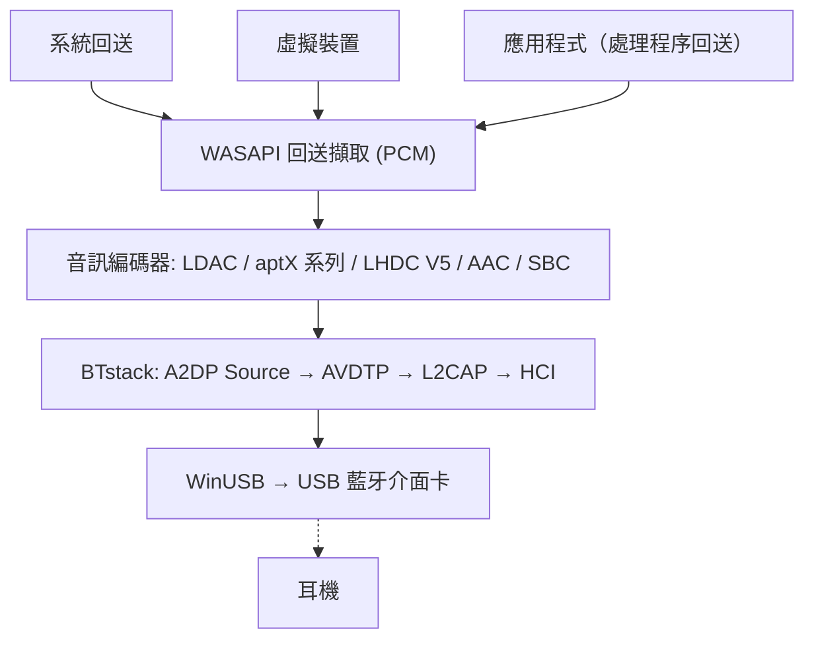

# A2DP Windows Bridge (A2DPWB)

適用於 Windows、支援所有轉碼器的藍牙 A2DP 音訊串流工具。
{: .fs-6 .fw-300 }

使用處於 WinUSB 模式的 USB 藍牙介面卡，以 **LDAC、aptX HD、aptX Low Latency、aptX、AAC、SBC** 及（實驗性）**LHDC V5** 串流系統音訊 -- 不需要核心驅動程式，也不需要測試簽章。

[開始使用](setup){: .btn .btn-primary .fs-5 .mb-4 .mb-md-0 .mr-2 }
[GitHub](https://github.com/SeiyaFunaokaJP/A2DP-Windows-Bridge){: .btn .fs-5 .mb-4 .mb-md-0 }

---

## 支援的轉碼器

| 轉碼器 | 位元率 | 取樣率 | 位元深度 | 延遲 |
|:------|:--------|:------------|:----------|:--------|
| LDAC | 330/660/990 kbps | 44.1--96 kHz | 16/24/32 bit | 約 200 ms |
| aptX HD | 576 kbps | 44.1/48 kHz | 24 bit | 約 150 ms |
| aptX Low Latency | 352 kbps | 44.1/48 kHz | 16 bit | 約 32 ms |
| aptX | 352/384 kbps | 44.1/48 kHz | 16 bit | -- |
| AAC | 128/192/256 kbps | 44.1/48 kHz | 16 bit | 約 150 ms |
| SBC | 最高約 345 kbps | 44.1/48 kHz | 16 bit | 約 150 ms |
| LHDC V5 🧪 | 400/500/900/1000 kbps，ABR 160--400 kbps | 44.1/48/96/192 kHz | 16/24 bit | -- |

### 各平台的轉碼器支援（傳送到耳機）

| 轉碼器 | Windows 10 內建 | Windows 11 內建 | Ubuntu 內建 (PipeWire) | **A2DPWB** (Windows 10 / 11) |
|:------|:-------------------:|:-------------------:|:--------------------------:|:----------------------------:|
| LDAC | ❌ | ❌ | ✅ | ✅ |
| aptX HD | ❌ | ❌ | ✅ | 🧪 實驗性 |
| aptX Low Latency | ❌ | ❌ | ✅ | 🧪 實驗性 |
| aptX | ✅ | ✅ | ✅ | ✅ |
| AAC | ❌ | ✅ | ❌ 不在 Ubuntu 的套件中 | ✅ |
| SBC | ✅ | ✅ | ✅ | ✅ |
| LHDC V5 | ❌ | ❌ | ❌ | 🧪 實驗性 |
| aptX Adaptive | ❌ | ❌ | ❌ | ❌ |

✅ 支援 · 🧪 實驗性 · ❌ 不支援。所有欄位皆為傳送端（PC → 耳機）。「內建」指不使用 A2DPWB 時作業系統本身的藍牙音訊；Ubuntu 欄位為 Ubuntu 26.04 的 PipeWire 轉碼器組合（`libspa-0.2-bluetooth`）。

{: .warning }
**aptX HD 與 aptX Low Latency 為實驗性功能。** 兩者依照 Android / PipeWire 的實作，並通過編碼/解碼往返測試，但尚未在實際耳機上驗證。此表中的延遲值為典型數值，並非以 A2DPWB 實測。

{: .warning }
**LHDC V5 為實驗性功能。** 它使用 Google 加入 Android 17 的 LHDC V5 編碼器（AOSP，Apache-2.0）的 C 語言移植版；此移植版已與 AOSP 的 Rust 編碼器比對驗證為位元完全一致，A2DP 訊號則依照 Android 的 `a2dp_vendor_lhdcv5`。尚未在實際的 LHDC 耳機上驗證。僅支援有損的 LHDC V5：LHDC V2/V3（較舊的耳機）與無損的「LHDC-RAW」模式沒有開放原始碼的編碼器。在「自動」模式下，LHDC V5 的優先順序低於 LDAC 與 aptX 系列，高於 AAC / SBC。

{: .note }
**只需要傳統 aptX？** Windows 10 的內建藍牙堆疊已支援傳統 aptX（不含 aptX HD、aptX LL 或 aptX Adaptive），因此不需要 A2DPWB。A2DPWB 主要適用於 LDAC、aptX HD 與 aptX Low Latency。

{: .note }
**不支援 aptX Adaptive**（沒有開放原始碼的編碼器）。如果您的耳機同時列出傳統 aptX，A2DPWB 會直接使用 aptX；否則「自動」會選擇 AAC 或 SBC。請參閱 [aptX 系列與 aptX Adaptive 相容性](usage#aptx-compatibility)。

## 平台支援

| 元件 | Windows 10 (x64) | Windows 11 (x64) | Linux (Ubuntu) |
|:----------|:----------------:|:----------------:|:--------------:|
| **A2DPWB** (GUI / CLI) | ✅（尚未在實機上試過） | ✅ | ❌ |
| [從原始碼建置](building)（Visual Studio 2022 以上） | ✅ | ✅ | ❌ |
| `a2dpwb_decode`（串流檢查工具） | ✅ | ✅ | ❌ |
| 端對端測試 `tools/emu/run_test.py` | ✅ | ✅ | ❌ |
| 虛擬介面卡 `tools/emu/emu_vhci.py` | ❌ | ❌ | ✅ |
| [測量用接收器](usage#receiver) `tools/linux_sink` | ❌ | ❌ | ✅ |

A2DPWB 本身僅能在 Windows 上以 x64 版本執行。Linux 工具需要 Python 3.11 以上（已在 Ubuntu 26.04 驗證）；`setup.sh` 以 Ubuntu / Debian 為對象，其他發行版需手動安裝套件。

## 已驗證的硬體

| 項目 | 環境 | 轉碼器 | 結果 |
|:-----|:------|:-------|:-------|
| Sony WH-1000XM4（耳機） | Windows 11 + TP-Link UB500 | LDAC, AAC, SBC | ✅ 可播放（XM4 不支援 aptX） |
| TP-Link UB500（Realtek RTL8761BU，介面卡） | Windows 11、WinUSB、linux-firmware `rtl8761bu` | – | ✅ |
| 測量用接收器 `tools/linux_sink` | Windows 11 + UB500 → Ubuntu 26.04，透過無線傳輸 | SBC, AAC, aptX, aptX HD, aptX LL, LDAC | ✅ 已接收並測量 |
| 虛擬連結 `tools/emu` (Bumble) | Windows 11，無無線電 | SBC, AAC, aptX, aptX HD, aptX LL, LDAC, LHDC V5 | ✅ 端對端測試通過 |

尚未在實機上試過 Windows 10。其他介面卡：請參閱 [建議的介面卡](setup#adapters)。

## 音訊擷取模式

A2DPWB 透過 WASAPI 擷取音訊，提供三種模式：

| 模式 | 說明 | 使用情境 |
|:-----|:------------|:---------|
| **系統回送** | 透過 WASAPI 回送，擷取預設播放裝置的所有系統音訊輸出 | 設定簡單 -- 串流所有聲音 |
| **虛擬裝置** | 從使用者選取的虛擬音訊裝置（例如 VB-CABLE、VoiceMeeter）擷取 | 將特定應用程式導向藍牙，其他音訊仍從喇叭播放 |
| **應用程式** | 僅擷取單一應用程式播放的內容（經該應用程式本身處理後）（Windows 11 / Windows 10 2004 以上） | 傳送單一應用程式，或系統層級效果應用程式（等化器、音效增強器）的輸出 |

在 **虛擬裝置** 模式下，A2DPWB 會將 Windows 預設播放裝置切換為所選的虛擬裝置，再擷取其回送輸出。輸出到該虛擬裝置的應用程式會透過藍牙串流。停止串流時，會還原先前的預設裝置。

系統回送不會把音訊從預設播放裝置上移走：音訊會同時在該裝置與藍牙上播放。請參閱 [擷取模式](usage#capture-modes)。

## 運作方式

A2DPWB 完全繞過 Windows 藍牙堆疊。它透過 WinUSB 直接與 USB 藍牙介面卡通訊，並使用 [BTstack](https://github.com/bluekitchen/btstack) 在使用者模式下實作完整的藍牙通訊協定堆疊。

## 功能

- **多轉碼器**：LDAC、aptX HD、aptX Low Latency、aptX、AAC、SBC，自動協商
- **三種擷取模式**：系統回送、虛擬音訊裝置路由，或單一應用程式的輸出
- **ABR**：針對不穩定連線的自適應位元率（LDAC 與 LHDC V5）
- **自動重新連線**：斷線時重新連線（最多 10 次）
- **連線品質與 AFH**：顯示傳送的內容、RSSI 與使用中的通道；告知介面卡應避開哪些 Wi-Fi 通道（請參閱 [使用方式](usage#link-quality)）
- **耳機控制 (AVRCP)**：與耳機及 Windows 音量同步的音量滑桿；耳機的播放/暫停、下一首與上一首按鈕可控制 PC 上的播放（請參閱 [使用方式](usage#headphone-buttons)）
- **設定檔管理**：儲存與載入裝置 + 轉碼器設定
- **GUI + CLI**：wxWidgets 圖形介面或命令列操作
- **多語系**：英文、日文、簡體中文、繁體中文、韓文、德文、法文、西班牙文
- **Realtek 韌體**：Realtek 介面卡的韌體下載引導
- **診斷**（偵錯模式）：偵錯主控台、HCI 擷取、與 Linux PC 進行對端接收器測試（請參閱 [使用方式](usage#receiver)）
